# Admin Panel, Runtime Configuration and Coupons — AI Resume / Job Match Optimizer

**Purpose.** This document designs the internal admin panel requested by the owner on 2026-09-29:

- an **admin panel** for running the product;
- **coupon codes**: single-use or limited use, a percentage off, set **per plan** (monthly, quarterly, and the others);
- **"everything configurable and traceable from the admin panel"**;
- **AI provider API keys** (e.g. OpenAI, NVIDIA's free models) entered from the admin panel, with **which model runs each step** chosen there;
- a proper **AI usage dashboard**: tokens and cost per step, per user, per model and per key, visualized so it can guide the next optimizations.

It covers the build-vs-buy decision, access control, modules, the runtime configuration system, AI providers and keys (§6.5), the coupon engine and its Paddle mapping, traceability, the analytics dashboards (§9), economics, security, effort and open questions. It is design only, with no production code.

Last updated: 2026-09-29 · Companion docs: [architecture.md](architecture.md) §10.5, [database-design.md](database-design.md) §3.6, [api-design.md](api-design.md) §6.16 and §11, [security-threat-model.md](security-threat-model.md) §11 (#22–30), [cost-analysis.md](cost-analysis.md) §11.5, [implementation-roadmap.md](implementation-roadmap.md) §2

**Labels:** **[FACT]** (with source, checked 2026-09-29) · **[ASSUMPTION]** · **[ESTIMATE]** · **[RECOMMENDATION]** · **[DECISION]** · **[OPEN QUESTION]**

---

## Table of contents

1. [Summary and decisions](#1-summary-and-decisions)
2. [Challenge: what should *not* be configurable](#2-challenge-what-should-not-be-configurable)
3. [Admin panel architecture (build vs buy)](#3-admin-panel-architecture-build-vs-buy)
4. [Access control](#4-access-control)
5. [Modules and screens](#5-modules-and-screens)
6. [Runtime configuration system](#6-runtime-configuration-system)
7. [Coupons and discounts](#7-coupons-and-discounts)
8. [Traceability](#8-traceability)
9. [Dashboards and analytics](#9-dashboards-and-analytics)
10. [Data model, API and security (pointers)](#10-data-model-api-and-security-pointers)
11. [Effort, cost and roadmap placement](#11-effort-cost-and-roadmap-placement)
12. [Open questions](#12-open-questions)
13. [Sources](#13-sources)

---

## 1. Summary and decisions

| ID | Decision | Choice | Main reason |
|---|---|---|---|
| AD-1 | Do we build an admin panel? | **Yes.** An internal web app at `admin.<domain>`. The MVP slice ships **before the paid launch**. | Coupons, support, quota fixes, kill switches and cost control can't be run safely from raw database edits |
| AD-2 | Build or buy | **Custom thin SPA** (`apps/admin`) on a **separate `admin-api` Worker**. No tool gets direct database access. | Every change must go through the same validation, Paddle sync and audit path (§3) |
| AD-3 | Access | **Cloudflare Access** (SSO + MFA; free up to 50 users) → Better Auth **admin roles** → per-permission checks → a dedicated Postgres role. **Impersonation is disabled.** | Defence in depth for the most powerful surface in the system (§4) |
| AD-4 | Configuration model | **Versioned, schema-validated config namespaces** in Postgres, published to Workers KV and to the signed extension config. Changes go draft → validate → diff → (eval gate) → activate (optionally staged) → roll back in one click. | "Configurable" without "one typo breaks production" (§6) |
| AD-5 | Invariants | A short list of things that are **deliberately not runtime-configurable**: truthfulness gates, score wording, the privacy posture, extension code and permissions, and **infrastructure** secrets | They protect users and the store listing; they change only via reviewed code (§2) |
| AD-6 | Coupons | **Our own coupon engine** (per-plan % and duration, total and per-user limits, new-customer rules, dates, budget caps). It applies **one non-checkout Paddle discount per plan rule**, attached server-side to a Paddle transaction. | Paddle's native codes can't enforce per-user limits, new-customer rules, or a different % per plan (§7) |
| AD-7 | 100% free access | **Complimentary entitlement grants** (Pro for N days, no Paddle involvement), not 100% coupons | Paddle's handling of $0 subscription checkouts isn't documented in what we checked; grants end on their own and stay out of revenue reports (§7.8) |
| AD-8 | Traceability | An **append-only, hash-chained audit log** covering every admin/system write **and every read of personal data**. Every AI request and optimization is stamped with a **config snapshot ID**. A unified **user timeline** shows metadata only. | Answer "who changed what", "which config produced this result" and "who looked at this user" (§8) |
| AD-9 | AI providers, models and API keys *(owner request)* | A **provider registry** (OpenAI, Anthropic, Google, and any OpenAI-compatible host such as NVIDIA) and a **write-only key vault**. The key is encrypted in the admin's browser, and only the API Worker can decrypt it. **Model + key per pipeline step**, with fallbacks, is set in the `ai_routing` config. A **data-policy rule in code** blocks routes the provider's terms don't allow. | The owner can add keys and switch models without a deploy. A trial key can never end up serving real users' resumes (§6.5). |
| AD-10 | AI usage dashboard *(owner request)* | Tokens, cost, latency and quality by **step, user, model, provider, key, plan, prompt and config version**. Built on `ai_requests` + hourly rollups in Postgres, with an **insights engine** (rule-based "what to optimize next") and a **what-if cost simulator** | The data already exists per call; turning it into decisions is the point (§9) |
| AD-11 | NVIDIA free API keys | **Development and evals only, with synthetic data.** Never production, never resume content. | [FACT] NVIDIA's API Trial Terms: "limited trial purposes only and without use of the API Service or Generated Content in production"; no personal data; content may be used "to improve NVIDIA products and services, including AI models" (§6.5.1) |

---

## 2. Challenge: what should *not* be configurable

The owner asked that **everything** be configurable. **[RECOMMENDATION]** Make nearly every business and operations setting configurable (plans, quotas, prices, coupons, models, prompt versions, scoring versions, portals, flags, limits, banners, retention within legal bounds). Keep the six categories below **out** of the admin panel. They change only through reviewed code, and for some of them a store review or a privacy-policy update as well.

| Not runtime-configurable | Why | What the admin panel *can* do instead |
|---|---|---|
| **Turning truthfulness gates off** (G0–G6 deterministic gates, revert-on-fail, user review) | Truthfulness is requirement #1. One misclick would ship invented claims to every user. | Tune thresholds **within bounds set in code** (e.g. the G7 entailment threshold); view gate-trip rates |
| **Score wording and the disclaimer** ("never call it an ATS score") | Consumer-protection and positioning risk ([product-requirements.md](product-requirements.md) §9) | Edit help text and FAQ copy that passes the same copy lint |
| **Privacy posture**: storing resume/JD content server-side, logging bodies, adding a provider without a DPA | Needs a privacy-policy change, user notice and CWS privacy-tab update, not a toggle | Choose only among providers marked `dpa_signed_at` + `zdr` in `ai_providers` |
| **Extension code and permissions** | [FACT] MV3 forbids remotely hosted code; manifest changes need a store review (https://developer.chrome.com/docs/extensions/develop/migrate/remote-hosted-code) | Ship **data-only** config (selectors, flags, limits, banner text) through the signed `/v1/config` |
| **Infrastructure secrets** (Paddle API and webhook keys, config-signing key, the key-vault private key, database credentials) | Showing or editing these in a web UI widens the blast radius, and some protect the admin panel itself | Show "configured / last rotated / environment"; rotate with the runbook |

**Changed on 2026-09-29 at the owner's request:** **AI provider API keys *are* managed in the admin panel**, but **write-only**. They are encrypted in the admin's browser, can never be displayed again, and only the API Worker can decrypt them (§6.5). The owner can add, test, rotate and revoke keys without a deploy, and a compromised admin session still can't read existing keys.
| **Refunds, chargebacks, payouts and tax** | Paddle is the merchant of record and owns these | Deep-link to the Paddle dashboard; mirror the resulting events into the user timeline |

One more deliberate limit: **changing a plan price never silently changes what existing subscribers pay.** A new price applies to new purchases. Moving existing subscribers is a separate, explicit, announced action. **[OPEN QUESTION]** for counsel: notice rules for price increases on renewals (Quebec Consumer Protection Act, other provinces, EU).

---

## 3. Admin panel architecture (build vs buy)

**Decision:** how should the admin panel be built and hosted?

| Option | Pros | Cons | Cost | Risk |
|---|---|---|---|---|
| **A. Custom SPA + separate `admin-api` Worker** (recommended) | Full control of validation, audit and Paddle sync; reuses `packages/db`, `packages/shared` (Zod) and billing code; same stack and deploy pipeline | ~3.5 engineer-weeks for the MVP slice (§11) | ≈ $0 extra: static assets + a Worker on the existing Workers Paid plan; Cloudflare Access free ≤ 50 users | We own its security (mitigated in §4) |
| B. Low-code internal tool (Retool, Appsmith, Budibase) wired to the DB | Fast CRUD screens | Direct DB writes **bypass** business rules, Paddle sync and the audit log unless everything is routed through our API anyway; a third party holds DB credentials; config versioning and traces still have to be custom-built | Per-seat pricing (not verified here) or self-hosting effort | Vendor access to personal data; drift between tool and rules |
| C. Admin routes inside the public API Worker | One deployment | Admin endpoints live on the internet-facing host; bigger blast radius for any auth bug | $0 | Higher |
| D. Vendor dashboards only (Paddle, Neon console, Cloudflare) | Nothing to build | No per-user trace, no config versioning, unaudited SQL edits, no per-user coupon rules | $0 | High operational risk |

**Recommendation: A.** Build the list, detail and form screens with an open-source admin framework (Refine or react-admin) on top of `/admin/v1`. **[ASSUMPTION]** Both have MIT-licensed cores; verify at build time. Keep the Paddle dashboard for refunds and payouts, and link to it.

**Reason:** "configurable and traceable" means every change has to pass through one choke point that validates, audits and syncs. Only a custom API gives us that without handing database credentials to another vendor.

```text
Admin's browser ──► Cloudflare Access (SSO + MFA, allow-list) ──► admin.<domain>  (static SPA)
                                                                     │ fetch: Access JWT + admin session
                                                                     ▼
                                             admin-api Worker (Hono) — separate deployment, no public routes
                                              ├─ verify Access JWT → admin session + role → permission
                                              ├─ every write: validate → apply → audit_log row, in ONE DB transaction
                                              ├─ Postgres via Hyperdrive (role admin_rw)
                                              ├─ Paddle API: discounts, prices (create/archive), subscriptions (read)
                                              ├─ Config publisher → Workers KV (server config) + signed /v1/config (extension)
                                              └─ UserQuota DO (RPC: reset or adjust counters)

Public API Worker (unchanged surface) ── reads config from KV ── stamps config_snapshot_id on every AI request
```

---

## 4. Access control

### 4.1 Layers

1. **Cloudflare Access** in front of `admin.<domain>` and `admin-api.<domain>`: named-email allow-list, Google as the identity provider with MFA enforced, 8–12 h sessions. [FACT] The Zero Trust free plan covers up to 50 users (https://www.cloudflare.com/plans/zero-trust-services/).
2. **`admin-api` verifies the Access JWT** on every request (issuer and audience), so bypassing the edge doesn't help. **[ASSUMPTION]** The JWT arrives in the `Cf-Access-Jwt-Assertion` header; confirm in the Cloudflare docs at build time.
3. **Better Auth admin plugin** roles, with custom permission statements per role. [FACT] The plugin provides RBAC, banning ("Banned users cannot sign in. Their existing sessions are revoked") and impersonation (https://better-auth.com/docs/plugins/admin). **[RECOMMENDATION] Remove `impersonate` from every role.** Resume content lives only on the user's device, so impersonation gives support almost nothing and would let an admin act as a user.
4. **Postgres role `admin_rw`**: DML only on admin-managed tables, `SELECT` on metadata tables, and **`INSERT` only** on `audit_log` ([database-design.md](database-design.md) §6.1).
5. **Step-up for dangerous actions:** re-authentication within the last 10 minutes, a typed reason, and a typed confirmation of the target (e.g. the coupon code). A **second approver** is required once the team has ≥ 2 admins (a config flag; off while the owner is the only admin).

### 4.2 Roles and permissions

| Permission | Owner | Admin | Support | Finance | Analyst (read-only) |
|---|:-:|:-:|:-:|:-:|:-:|
| View dashboards and metrics | ✅ | ✅ | ✅ | ✅ | ✅ |
| View a user (masked email, plan, usage, timeline) | ✅ | ✅ | ✅ | ✅ | – |
| Reveal a full email (audited) | ✅ | ✅ | ✅ | ✅ | – |
| Grant credits or complimentary access; reset a quota | ✅ | ✅ | ✅ (≤ 10 credits, ≤ 14 days) | – | – |
| Suspend or unsuspend a user | ✅ | ✅ | ✅ | – | – |
| Start account deletion for a user (on their request) | ✅ | ✅ | ✅ | – | – |
| Create, edit or pause coupons | ✅ | ✅ | Pause only | ✅ | – |
| Coupons > 50% off or "forever" duration | ✅ | – | – | – | – |
| Plans: limits and features | ✅ | ✅ | – | – | – |
| Plans: prices (creates a Paddle price) | ✅ | – | – | ✅ | – |
| AI routing (model + key per step), budgets, prompt versions, scoring versions | ✅ | ✅ | – | – | – |
| Add, rotate or revoke **provider API keys**; edit a provider's data-policy flags | ✅ (step-up) | – | – | – | – |
| Test a key (synthetic prompt) | ✅ | ✅ | – | – | – |
| AI usage dashboards (aggregates: steps, models, keys, plans) | ✅ | ✅ | ✅ | ✅ | ✅ |
| AI usage **per user** (masked; drill-down audited) | ✅ | ✅ | ✅ | ✅ | – |
| Accept or dismiss optimization insights | ✅ | ✅ | – | – | – |
| Feature flags, portals, limits, banners | ✅ | ✅ | Banners only | – | – |
| Kill switches | ✅ | ✅ | **Turn off only** (on-call) | – | – |
| View traces and the audit log | ✅ | ✅ | Own actions + users they handle | ✅ (billing) | Aggregates only |
| Export (CSV) | ✅ | ✅ | – | ✅ (billing) | Aggregates only |
| Manage admins and roles | ✅ | – | – | – | – |

---

## 5. Modules and screens

| # | Module | You can see | You can do | Traced as |
|---|---|---|---|---|
| 1 | **Overview** | Sign-ups, MAU, paid users by plan, MRR (from the Paddle mirror), AI cost today/MTD vs budget, gate-trip rate, error rate, active coupons | – | – |
| 2 | **Users and support** | Search by email, user ID or Paddle customer ID; masked email, plan, quota, credits, grants, sessions, timeline (§8.4) | Grant credits or complimentary access, reset a quota, suspend, revoke sessions, start deletion, resend verification | `user.*` audit rows; every profile view is a `user.view` row |
| 3 | **Subscriptions** | Mirror of Paddle subscriptions and transactions, including coupons | Open in Paddle (refunds happen there) | `subscription_events` |
| 4 | **Plans and pricing** | Plans, limits, features, active and archived prices | Edit limits and features (config); create a new price in Paddle; archive the old one; reorder or hide plans | `config.*`, `price.*` |
| 5 | **Coupons and campaigns** | Coupons, codes, per-plan rules, redemptions, campaign stats (§7.9) | Create (single, shared or bulk), pause, resume, extend, archive, export codes | `coupon.*` |
| 6 | **Credits and complimentary access** | Grants and their expiries | Grant or revoke | `grant.*` |
| 7 | **AI providers, keys and routing** (§6.5) | Providers with data-policy badges (production allowed? personal data allowed? trains on inputs?); keys (masked `••••1a2b`, scope, status, last used, spend this month, last test); models with capabilities, price book and eval results; the **routing matrix** (step × primary/fallbacks/canary) | Add, test, rotate and revoke keys; add an OpenAI-compatible provider (e.g. NVIDIA) and its models; **pick the model and key for each step**, fallback order, token caps, reasoning effort, timeouts; canary a new model | `credential.*`, `provider.*`, `config.*` (eval gate required, §6.3) |
| 8 | **Prompts and evals** | Prompt versions, eval results, rollout % | Promote a version to shadow, canary or live; roll back. Prompt **text** is authored in git and reviewed. | `config.*` |
| 9 | **Scoring** | Scoring versions, weights, golden-set regression results | Activate a new scoring version | `config.*` |
| 10 | **Job-portal extraction** | Adapters, per-host extraction success rate (no content) | Edit selectors; enable or disable a portal, e.g. on a legal takedown | `config.*` |
| 11 | **Feature flags and kill switches** | Flags by plan, user, % rollout and extension version; switch states | Toggle | `config.*` |
| 12 | **Limits and abuse** | Rate limits, input caps, disposable-domain list, blocked users | Edit within bounds; block or unblock | `config.*`, `user.*` |
| 13 | **Announcements** | In-panel banners | Create a plain-text banner (≤ 280 chars, allow-listed links only) targeted by plan or version | `config.*` |
| 14 | **Traces** | Request explorer by request ID, optimization ID or user (§8.3) | – | Views are audited |
| 15 | **Audit log** | Search by actor, target, action and date | Export (itself audited) | `audit.export` |
| 16 | **Privacy requests** | Deletion and export requests with step status and SLA timers | Retry a failed step | `privacy.*` |
| 17 | **Feedback** | Ratings and reason codes; comments (Support and above; content only if the user shared it) | Tag or close | `feedback.view` |
| 18 | **Admins** | Admins, roles, last sign-in | Invite, change a role, revoke (Owner only) | `admin.*` |
| 19 | **System health** | Workflow failures, Paddle webhook failures with replay, config publish status, links to Sentry and Better Stack | Replay a webhook | `system.*` |
| 20 | **AI usage and cost analytics** (§9) | Tokens (input, cached, output, reasoning), cost, latency and failures by step, user, model, provider, key, plan, prompt and config version; per-optimization waterfall; trends and forecasts | Filter, compare periods, drill down, export CSV | Per-user drill-downs are audited |
| 21 | **Optimization insights and what-if** (§9.5–9.6) | Rule-based findings ("reasoning tokens on `optimize` are 2.4× budget: ≈ $X/month") with evidence charts; re-pricing of past traffic on another model | Accept (creates a draft config change that goes through the eval gate) or dismiss with a reason; track the measured effect | `insight.*` |

### 5.1 Wireframe: create a coupon

```text
┌ New coupon ────────────────────────────────────────────────────────────────────────────┐
│ Codes     (•) One code [ LAUNCH30        ] (Generate)                                   │
│           ( ) Bulk     [ 100 ] unique single-use codes, prefix [ INF- ]                 │
│ Name      [ Launch week — Reddit post      ]   Campaign [ launch-2026-10 ▾ ]            │
│                                                                                         │
│ Discount per plan                                                                       │
│   ☑ Pro monthly   ($19/mo)   [ 20 ]% off   for [ first payment only ▾ ]                 │
│   ☑ Pro quarterly ($45/qtr)  [ 30 ]% off   for [ 2 billing periods ▾ ]                  │
│   ☐ BYOK annual   ($39/yr)   [    ]% off                                                │
│   ☐ Credit pack   ($12)      [    ]% off                                                │
│                                                                                         │
│ Limits    Total uses [ 200 ]  (1 = single-use code; blank = unlimited)                  │
│           Per user   [ 1 ]    ☑ New customers only    Stop after $[ 500 ] discount given │
│ Valid     From [ 2026-10-15 09:00 ET ]   Until [ 2026-10-22 23:59 ET ]                   │
│                                                                                         │
│ Preview   Pro quarterly: $45.00 → $31.50 for 2 quarters, then $45.00.                   │
│           Paddle fee ≈ $2.08 · typical AI cost $4.56 · contribution ≈ $24.87/qtr  ✓     │
│           Pro monthly: $19.00 → $15.20 for the first month, then $19.00.   ✓            │
│ Reason    [ required                                    ]      [Cancel] [Create coupon] │
└─────────────────────────────────────────────────────────────────────────────────────────┘
```

### 5.2 Wireframe: user trace (support view)

```text
User 01J8Q… · a***@gmail.com [reveal] · Pro quarterly (LAUNCH30) · CA-ON · joined 2026-10-15
Quota 41/150 optimizations · 2/25 today · AI $1.92/$8.00 · credits 0 · grants: none
Timeline (newest first)                                                  filter [ all ▾ ]
2026-10-20 14:02  optimization 01JB… succeeded · score 58→71 (ceiling 74)
                  gates G2 0 · G3 0 · G7 1 reverted · cost $0.051 · 38.2 s
                  config cs_7f3a91c2e0b4 · optimize@v3 · openai:gpt-6-sol           [trace ▸]
2026-10-20 14:01  jobs/analyze · cache hit (jd_hash 9f3c…) · cost $0
2026-10-18 10:30  ADMIN support@… granted 5 credits · "export bug #212"        [audit #8812]
2026-10-15 09:14  subscription.created · pro_quarterly · $31.50 (LAUNCH30 −30%) · txn_01…
2026-10-15 09:12  coupon LAUNCH30 reserved → completed
2026-10-15 09:05  signed up (Google) · consent 2026-09
```

There is **no resume or job text** on this screen. The server never has it (§8.6).

---

## 6. Runtime configuration system

### 6.1 Namespaces

| Namespace | What it controls (examples) | Consumed by | Guardrails (bounds live in code) | Who |
|---|---|---|---|---|
| `plans` | Quotas per plan (optimizations/month and /day, analyses, AI $ budget), features per plan, visibility, order, badges | API (UserQuota DO), extension (display) | AI budget ≤ 50% of the plan's monthly price; quotas ≤ 5× the defaults | Owner, Admin |
| `ai_routing` | **Model + API key per step**, fallback chain, canary, `max_output_tokens`, reasoning effort, timeouts, retries, per-key monthly soft budget | AI router | Only `approved` models; **data-policy rule** (§6.5.3); **eval gate** (§6.3) | Owner, Admin |
| `budgets` | Per-user $ budget, 80% downgrade threshold, global daily ceiling, free-tier pause | Router, DO | Ceiling ≤ an owner-set maximum | Owner |
| `prompts` | Live prompt version per task, canary %, shadow | Router | The version must have a **passing `eval_runs` row** | Owner, Admin |
| `scoring` | Category weights, state values, hard-missing gate, keyword saturation, confidence weights → a new `scoring_version` shown beside the score | Extension (signed config), API | Weights sum to 1; golden-set regression required; before/after always use the same version | Owner |
| `extraction` | Site adapters (selectors), per-portal enable, JD size cap | Extension (signed config) | Schema: selectors only, no URLs or scripts | Admin |
| `features` | Flags by plan, user allow-list, % rollout (hash of user ID), extension version | API, extension | – | Admin |
| `kill_switches` | Hosted AI, sign-ups, checkout, coupon redemption, per provider, per portal, sync; maintenance mode | API, extension | Instant, no eval gate | Owner, Admin, Support (off only) |
| `limits` | Burst rate limits, input caps, OTP limits, disposable-domain list | API | Minimums enforced (e.g. OTP ≤ 10/hour) | Admin |
| `announcements` | Banner text, audience, dates | Extension | Plain text ≤ 280 chars; allow-listed link domains | Admin, Support |
| `retention` | Days per table | Nightly jobs | Between legal minimums and the privacy-policy maximums | Owner |
| `coupons_policy` | Maximum % for shared codes, maximum validity, default per-user limit, alert thresholds | Coupon engine | Hard caps in code (§7.9) | Owner |
| `insights` | Thresholds for the optimization-insight rules and AI alerts (§9.5), the reference model for "shadow cost" of free models | Analytics jobs | – | Owner, Admin |

Coupons, credits and grants are **records** with their own tables and audit rows, not config documents.

### 6.2 Lifecycle of a config change

```mermaid
stateDiagram-v2
  [*] --> draft: edit in admin (JSON form generated from the Zod schema)
  draft --> validated: schema + cross-field rules + bounds
  validated --> approved: diff vs active reviewed; impact preview; eval gate if required; 2nd approver if enabled
  approved --> canary: activate at N% (hash of user id)
  approved --> active: activate at 100%
  canary --> active: metrics OK → promote
  canary --> rolled_back: auto-rollback trigger or manual
  active --> superseded: a newer version becomes active
  active --> rolled_back: one-click rollback (re-activates the previous version)
```



- **Impact preview** before activation. Examples: "affects 312 Pro users"; for a model change, the estimated cost delta from the last 7 days of `ai_requests` × the new price book.
- **Auto-rollback triggers** for canaries of `ai_routing`, `prompts` and `scoring`: gate-trip rate, `processing_failed` rate, cost per optimization or p95 latency above baseline + X% over 30 minutes. X is itself config, bounded in code.
- **Every transition writes an audit row** with before/after, reason and actor. Versions are immutable. A rollback is a new activation of an old version, never an edit.

### 6.3 Eval gate for AI and scoring changes

A version of `ai_routing`, `prompts` or `scoring` can be activated only if an `eval_runs` row exists for exactly that combination and meets the hard thresholds in [ai-model-comparison.md](ai-model-comparison.md) §9.2 (e.g. zero fabricated claims on the golden set). The admin panel shows the eval report next to the Activate button. This keeps "configurable" from quietly undoing "truthful".

### 6.4 Distribution and propagation

1. **Postgres is the source of truth** (`config_versions`, [database-design.md](database-design.md) §3.6).
2. On activation, the publisher compiles two documents:
   - **server config** → Workers KV;
   - **extension config** → signed with Ed25519 and served by `GET /v1/config` (the existing signed flat config).
3. [FACT] KV is eventually consistent. Changes "may take up to 60 seconds or more to be visible in other global network locations" (https://developers.cloudflare.com/kv/concepts/how-kv-works/). **So config and kill switches take effect within about a minute.** When seconds matter, the faster brakes are the provider-side spend caps and the global circuit breaker ([cost-analysis.md](cost-analysis.md) §13).
4. The extension refetches config when the panel opens and every 6 hours via `chrome.alarms`. It keeps the last known-good copy if the signature or schema check fails.
5. Each API request resolves a **config snapshot ID** once at the start: a short hash over the active version IDs of all namespaces. It is stored on `optimizations` and `ai_requests` (§8.2).

### 6.5 AI providers, models and API keys

The owner asked on 2026-09-29 to paste API keys (OpenAI, or free models from NVIDIA) into the admin panel and choose there which model, with which key, runs each step.

#### 6.5.1 Challenge: NVIDIA's free keys can't serve real users

[FACT] NVIDIA API Trial Terms of Service (v. September 19, 2025; https://assets.ngc.nvidia.com/products/api-catalog/legal/NVIDIA%20API%20Trial%20Terms%20of%20Service.pdf, checked 2026-09-29):

- §1.2: access is "for limited trial purposes only and without use of the API Service or Generated Content in production".
- §2.6(a): you agree not to include "personal data (unless expressly permitted by an API Service)". A resume is personal data.
- §3.3: NVIDIA will collect "User Content and Generated Content to improve NVIDIA products and services, including AI models", and use "will be logged for security, fraud or abuse monitoring and shared with third party service providers".
- §4.8: you "will not bypass, disable, or circumvent any technical aspect of the API Service", so no pooling several free keys to get around limits.

[FACT] NVIDIA's FAQ: free NIM API access through the Developer Program "is for prototyping, research, development and testing purposes only". Production needs an NVIDIA AI Enterprise licence, which "start[s] at $4500 per GPU per year" (https://docs.api.nvidia.com/nim/docs/product). [FACT-SECONDARY] The free tier is commonly reported at about 40 requests/minute (https://decodethefuture.org/en/nvidia-nim-api-pricing-limits-guide/).

**What free NVIDIA keys *are* good for:**

- Prompt experiments and **evals on synthetic resumes and public job descriptions**.
- **Shortlisting open models** at zero cost before paying anyone.

If an open model wins, run it in production on a host whose terms allow production use and personal data, under a DPA. [FACT] For example, Cloudflare Workers AI prices are in [ai-model-comparison.md](ai-model-comparison.md) §2.5.

**The savings are smaller than they look.** [ai-model-comparison.md](ai-model-comparison.md) §2.5: at $0.10/$0.50, GPT-6 Luna already costs about the same as hosted 8B open models. The real cost is the strong-model rewrite (cost-analysis §4), where an open model would first have to match GPT-6 Sol on factuality.

#### 6.5.2 Provider registry, model registry and key vault

| Object | What it holds | Who edits |
|---|---|---|
| **Provider** | `kind` (`openai` · `anthropic` · `google` · `openai_compatible`); `base_url` for compatible hosts (NVIDIA API Catalog, Workers AI, Groq, Together, self-hosted NIM or vLLM); **data-policy flags**: `production_allowed`, `personal_data_allowed`, `trains_on_inputs` (yes/no/unknown), retention note, `dpa_signed_at`, `zdr`; the **terms URL and review date** backing each flag | Owner only (step-up + reason). Seeded from our research: NVIDIA trial = production ✗, personal data ✗, trains on inputs ✓ |
| **Model** | Provider model ID; capabilities (strict JSON Schema / JSON mode only / none, context window, reasoning control); effective-dated prices and source URL; `token_factor`; status `candidate → eval_only → approved → retired`; tasks it passed evals for | Owner, Admin. Promotion to `approved` for a task needs a passing eval run on that task. |
| **Key (credential)** | Provider; label; environment (`production`, `staging`, `eval`); **scope** (`production` or `non_production`); ciphertext; `last4`; status (`active`, `standby`, `revoked`); monthly soft budget; last used; last test result | Owner only (add, rotate, revoke); Admin can test |

**Write-only key vault:**

1. The admin-api publishes the vault's **public** key (RSA-OAEP-256).
2. In the **admin's browser**, WebCrypto generates a random AES-256-GCM data key, encrypts the pasted API key with it, and wraps the data key with the public key. Only `{ciphertext, wrapped_key, iv, key_version, last4}` is sent. **The plaintext never reaches the admin-api, its logs or the database.**
3. Only the **API Worker** holds the private key, as a Cloudflare secret. The AI router decrypts a key on first use and keeps it in memory for ≤ 10 minutes.
4. **Test key:** the admin-api asks the API Worker over an internal service binding (not a public route) to send a tiny **synthetic** prompt. It returns ok/fail, latency, the error class, and whether JSON mode works.
5. **Rotation:** add the new key → make it active → set the old one to standby → revoke. Each step is audited. Revoking in the panel stops use within ~60 s (KV propagation), but **also revoke at the provider**, which is the real kill switch.
6. Multiple keys per provider are fine for separating environments, failover and rotation. **Not** for multiplying rate limits: that breaks NVIDIA §4.8 and very likely other providers' terms.
7. Keys are never shown again, not even to the Owner. A compromised admin session can add or revoke keys, which is audited and alerted, but can't read them.

**Relationship to BYOK:** these are **our** keys for hosted mode. A user's BYOK key still stays in their browser and never reaches our servers ([security-threat-model.md](security-threat-model.md) §5).

#### 6.5.3 Model and key per step: the `ai_routing` config

```json
{
  "routes": {
    "jd_extract":      { "primary":  { "model": "openai:gpt-6-luna", "credential": "cred_openai_prod_1" },
                         "fallbacks": [ { "model": "google:gemini-3.1-flash-lite", "credential": "cred_google_prod_1" } ],
                         "max_output_tokens": 1500, "reasoning": "none", "timeout_ms": 20000 },
    "resume_extract":  { "primary":  { "model": "openai:gpt-6-luna", "credential": "cred_openai_prod_1" }, "max_output_tokens": 3000 },
    "match_map":       { "primary":  { "model": "openai:gpt-6-luna", "credential": "cred_openai_prod_1" }, "max_output_tokens": 1500 },
    "optimize":        { "primary":  { "model": "openai:gpt-6-sol",  "credential": "cred_openai_prod_1" },
                         "fallbacks": [ { "model": "anthropic:claude-sonnet-5-5", "credential": "cred_anthropic_prod_1" } ],
                         "max_output_tokens": 4000, "reasoning": "low", "timeout_ms": 90000 },
    "validate_entail": { "primary":  { "model": "openai:gpt-6-luna", "credential": "cred_openai_prod_1" }, "max_output_tokens": 800 },
    "repair":          { "primary":  { "model": "openai:gpt-6-sol",  "credential": "cred_openai_prod_1" }, "max_output_tokens": 1500 }
  },
  "canary": { "optimize": { "model": "anthropic:claude-sonnet-5-5", "credential": "cred_anthropic_prod_1", "pct": 10 } },
  "credential_budgets_usd": { "cred_openai_prod_1": 1500, "cred_anthropic_prod_1": 400 }
}
```

The **eval** environment has its own `ai_routing` document. That is where a route like `"jd_extract": {"model": "nvidia:<catalog-model-id>", "credential": "cred_nvidia_trial"}` belongs.

**Data-policy rule** (in code, so it can't be configured away). An activation is **rejected** if any route breaks it:

| Rule | Why |
|---|---|
| A production route needs a key with scope `production` **and** a provider with `production_allowed` | NVIDIA trial §1.2 (and similar trial terms elsewhere) |
| Steps that carry resume content (`resume_extract`, `match_map`, `optimize`, `validate_entail`, `repair`) need `personal_data_allowed` **and** `trains_on_inputs = no` | Privacy policy, PIPEDA/Law 25 commitments, NVIDIA §2.6(a) and §3.3 |
| `jd_extract` (public job text only) still needs `production_allowed` in production | Production use is the restriction even when no personal data is involved |
| The model must be `approved` for that step (a passing eval on that step) | Truthfulness and schema reliability ([ai-model-comparison.md](ai-model-comparison.md) §9) |
| The eval harness sends only **synthetic** datasets to providers without `personal_data_allowed` | Keeps free keys usable for evals without breaking their terms |

If the Owner flips a provider's flag (e.g. after buying a production licence), the change needs a reason and a terms URL, is audited, and raises an alert. The flag is a recorded, accountable attestation, not a silent toggle.

**OpenAI-compatible hosts:**

- The router gets a generic `openai_compatible` adapter (base URL + key + model ID).
- [ASSUMPTION] NVIDIA's hosted catalog accepts OpenAI-style chat-completion requests at `https://integrate.api.nvidia.com/v1` (widely documented in secondary sources; confirm at build time).
- Hosts without strict JSON-Schema output run in JSON mode + Zod validation + one retry. A model is approved for a step only if its eval **schema-failure rate is ≤ 1%**.

#### 6.5.4 Wireframe: routing matrix

```text
┌ AI routing — production (active v14 · draft v15) ───────────────────────────────────────────────────────┐
│ Step            Primary                      Fallback 1                    Canary          Max out  Eval │
│ jd_extract      gpt-6-luna · openai-prod-1   flash-lite · google-prod-1     –               1,500    ✓   │
│ resume_extract  gpt-6-luna · openai-prod-1   –                              –               3,000    ✓   │
│ match_map       gpt-6-luna · openai-prod-1   –                              –               1,500    ✓   │
│ optimize        gpt-6-sol  · openai-prod-1   sonnet-5-5 · anthropic-prod-1  sonnet-5-5 10%  4,000    ✓   │
│ validate_entail gpt-6-luna · openai-prod-1   –                              –                 800    ✓   │
│ repair          gpt-6-sol  · openai-prod-1   –                              –               1,500    ✓   │
│                                                                                                         │
│ ✗ Draft v15: jd_extract → nvidia:<model> · nvidia-trial — BLOCKED: key scope non_production;            │
│   provider "NVIDIA API Catalog (trial)" is not allowed in production (terms §1.2).                       │
│   → Use it in the EVAL routing instead, or add a production-licensed host.                              │
│ Impact preview (v15 vs v14, last 7 days re-priced): −$41/month · schema-fail rate unknown (no eval)    │
│ [Run eval] [Save draft] [Activate…] (disabled)                                                          │
└─────────────────────────────────────────────────────────────────────────────────────────────────────────┘
```

---

## 7. Coupons and discounts

### 7.1 Requirements (owner, 2026-09-29)

- A coupon code that **can be used once**.
- **How many percent off.**
- **Configurable per plan** (monthly, quarterly, and the others).

"Used once" can mean three different things. The engine supports all three as separate settings:

| Setting | Meaning | Example |
|---|---|---|
| **Total uses** (`max_redemptions`) | How many times the code can be redeemed across **all** users. `1` = a truly single-use code. | A code sent to one person |
| **Uses per user** (`max_per_user`, default **1**) | How many times **one account** can use a shared code | A public launch code: 200 people, once each |
| **Duration** | How many **billing periods** the discount lasts: *first payment only*, *N periods*, or *forever* | 30% off the first 2 quarters |

### 7.2 Coupon fields

| Field | Values | Notes |
|---|---|---|
| Codes | One code, or a **bulk batch** of N unique single-use codes with a prefix | Codes are stored upper-case and matched case-insensitively. Generated codes use 10 characters from a 31-character alphabet with no `0/O/1/I/L` (≈ 8 × 10¹⁴ combinations). |
| Per-plan rules | For each selected plan: **% off** (1–100) and **duration** | A different % per plan is allowed (20% monthly, 30% quarterly). Plans: `pro_monthly`, `pro_quarterly`, `byok_annual`, `credit_pack`. Duration is ignored for one-time items. |
| Total uses / per-user uses | Integers; total blank = unlimited | Bulk codes: 1 use per code, plus an optional batch total |
| New customers only | Yes/no | "New" = no earlier completed paid transaction on the account |
| Allowed email domains | Optional list | E.g. a university partnership |
| Valid from / until | Dates with a time zone | **Until is required** (≤ 180 days by default; `coupons_policy`) |
| Stop after $X discount given | Optional budget | Auto-pauses the coupon when reached |
| Restore use on refund | Yes/no (default no) | Whether a refunded redemption frees up the use again |
| Campaign | Tag | For reporting |
| Status | draft · active · paused · expired · archived | Coupons are never deleted; history must stay traceable |

**Editing rules:** after the first redemption, the **% off, plans and duration are frozen**, because what a customer got must stay provable. You can still rename the coupon, extend or shorten the dates, raise or lower the total (not below the uses so far), pause, resume or archive it. For different terms, create a new coupon.

### 7.3 Why our own engine instead of Paddle's native codes

[FACT] Paddle discounts support `type` (percentage / flat / flat_per_seat), `amount`, `code`, `enabled_for_checkout`, `recur`, `maximum_recurring_intervals`, `usage_limit`, `restrict_to` (product or price IDs), `expires_at` and `discount_group_id` (https://developer.paddle.com/build/products/offer-discounts-promotions-coupons/). Its limits for our requirements:

- [FACT] "Amount-based limits are a total limit for the discount, rather than a per-customer limit." So Paddle can't enforce **once per user** or **new customers only** on its own.
- One Paddle discount has **one amount**, so a different % per plan needs one discount per plan.
- A code typed into Paddle's checkout field would **bypass** our rules.

**Design:**

1. Codes live **only in our database**.
2. For each per-plan rule, the admin-api creates one Paddle discount with:
   - `type: percentage`, `amount: "<pct>"`;
   - `enabled_for_checkout: false` and no `code`;
   - `restrict_to: [<that plan's Paddle price ID>]`;
   - `recur` / `maximum_recurring_intervals` from the duration;
   - `usage_limit` = the coupon's total, as a backstop;
   - `expires_at` = valid until + 2 h grace.
3. [FACT] Discounts with `enabled_for_checkout: false` "can only be applied by passing the discount to the checkout or transaction directly using its `id`" (same source). Our server applies the discount **only after our rules pass**.
4. [FACT] Paddle.js `settings.showAddDiscounts` controls "Whether the option to add a discount is displayed at checkout" (https://developer.paddle.com/paddle-js/methods/paddle-checkout-open/). Set it to `false` so customers can't try other codes.

**Duration mapping:**

| Our duration | Paddle fields | Note |
|---|---|---|
| First payment only | `recur: false` | – |
| N billing periods | `recur: true`, `maximum_recurring_intervals: N` | [FACT] "a recurring discount set for 4 billing periods applies to the initial transaction and the next 3 renewals", so N **includes** the first payment. **[OPEN QUESTION]** Confirm in the sandbox for 3-month prices. |
| Forever | `recur: true`, `maximum_recurring_intervals: null` | Owner-only (§4.2) |

[FACT] Quarterly plans are Paddle prices with `billing_cycle: {interval: "month", frequency: 3}` (https://developer.paddle.com/api-reference/prices/create-price/). "2 billing periods" on the quarterly plan therefore means 6 months.

### 7.4 Redemption flow

```mermaid
sequenceDiagram
  participant P as Side panel (Upgrade screen)
  participant A as API Worker
  participant DB as Postgres
  participant PD as Paddle API
  participant W as Web checkout page (Paddle.js)
  P->>A: POST /v1/billing/coupons/preview {code, plan_id}
  A->>DB: look up code + rules (read-only)
  A-->>P: 30% off 2 quarters: $45.00 → $31.50 (or a reason code)
  P->>A: POST /v1/billing/checkout {plan_id, coupon_code} + Idempotency-Key
  A->>DB: one transaction: lock coupon row, re-check every rule, insert redemption (reserved, 60 min)
  A->>PD: create transaction {items:[price], customer, discount_id, custom_data:{user_id, redemption_id}}
  PD-->>A: txn_… + checkout URL
  A-->>P: {checkout_url}
  P->>W: open tab → Paddle.Checkout.open({transactionId, settings:{showAddDiscounts:false}})
  PD-->>A: webhook transaction.completed (discount_id, totals)
  A->>DB: redemption → completed (amounts); subscription row → coupon ref; audit row
  Note over A,DB: Every 10 min: reservations past 60 min → released (the use becomes available again)
```

The validation order is fixed and each check has its own reason code: exists and active → within dates → plan allowed → email domain → new-customer rule → per-user uses → total uses (reserved + completed) → budget left. To make guessing harder, *not found*, *paused* and *archived* all return the same `invalid` reason.

### 7.5 Edge cases

| Case | Behaviour |
|---|---|
| Checkout abandoned | The reservation expires after 60 min and the use is released. A single-use code becomes usable again. |
| Two users race for the last use | The row lock serializes them; the second gets `limit_reached` |
| Code expires while the user is paying | The Paddle discount has a 2-hour grace period. **[OPEN QUESTION]** Does Paddle still honour a discount that expires on an already-created transaction? Test in the sandbox. |
| Refund | The redemption is marked `refunded`. The use is restored only if "restore use on refund" is on. |
| Plan switch mid-discount (monthly → quarterly) | **[OPEN QUESTION]** Paddle's behaviour for a discount restricted to the old price. **Policy:** the discount ends on a plan switch unless the new plan has a rule on the same coupon. State this in the checkout terms. |
| Cancel and resubscribe | Treated as a new redemption; the per-user and new-customer rules usually block it |
| Multiple accounts farming "new customer" codes | Existing controls (one account per verified email or Google identity, disposable-email blocking) plus per-coupon domain limits and budget caps. Residual risk accepted. |
| Currency | Percentage discounts work in any currency. [FACT] Flat discounts are currency-specific (Paddle docs), which is one more reason to start with percentages only. |
| Tax | **[ASSUMPTION]** Paddle computes tax on the discounted amount; verify with a sandbox receipt |
| Code leaked to a coupon site or browser coupon extension | Redemption-spike alert (§9) with optional auto-pause; use single-use codes for partners and influencers |
| Guessing codes | 10 validation attempts/minute and 50/day per user; generic `invalid` reason; long random codes for bulk batches |

### 7.6 Bulk codes

A bulk batch generates N unique single-use codes under one coupon. The codes share the per-plan rules and Paddle discounts, each code has `max_uses = 1`, and there can be a batch-wide total. Export is a CSV download from the admin panel. The export is audited and the codes are shown only once. Use batches for influencer or partner programmes and for support "sorry" codes.

### 7.7 How a coupon appears to the user

- On the Upgrade screen, a small "Have a code?" link sits under the plan cards. There's no permanent code box, which encourages people to leave and search for codes.
- After a valid code, each eligible plan card shows the before and after price and plain terms: *"30% off your first 2 quarters, then $45.00 every 3 months."* Plans the code doesn't cover say *"This code doesn't apply to this plan."*
- The user's account screen shows the active discount and when it ends. There is no surprise price jump at renewal: the renewal date and the full price are always visible ([product-requirements.md](product-requirements.md) §8.13).

### 7.8 Complimentary access instead of 100% codes

For free Pro access (beta testers, partners, support make-goods), the admin grants **Pro for N days** (≤ 90 per grant, renewable). This happens entirely in our database with no Paddle transaction. The effective plan is the higher of the paid subscription and any active grant. Quotas and the AI budget still apply. The grant shows in the user timeline and ends by itself.

**Why not a 100% coupon:** Paddle's handling of $0 subscription checkouts (payment method required? fees?) is not documented in the pages checked (**[OPEN QUESTION]**). A $0 "subscription" also inflates subscriber counts and muddies revenue reports.

### 7.9 Economics and guardrails

Figures per billing period, using the cost model in [cost-analysis.md](cost-analysis.md) §11: Paddle fee 5% + $0.50; typical paid-user AI cost $1.52/month; worst-case capped AI cost $7.90/month. **[ESTIMATE]**

| Plan and discount | Customer pays | Paddle fee | Contribution (typical use) | Contribution (worst case, capped) |
|---|---:|---:|---:|---:|
| Pro monthly, none | $19.00 | $1.45 | $16.03 | $9.65 |
| Pro monthly, 20% | $15.20 | $1.26 | $12.42 | $6.04 |
| Pro monthly, 30% | $13.30 | $1.17 | $10.62 | $4.24 |
| Pro monthly, 50% | $9.50 | $0.98 | $7.01 | $0.63 |
| Pro quarterly, none | $45.00 | $2.75 | $37.69 | $18.55 |
| Pro quarterly, 20% | $36.00 | $2.30 | $29.14 | $10.00 |
| Pro quarterly, 30% | $31.50 | $2.08 | $24.87 | $5.73 |
| Pro quarterly, 50% | $22.50 | $1.63 | $16.32 | **−$2.83** |
| Complimentary grant (in place of 100%) | $0 | $0 | −$1.52/month | −$7.90/month |

**[RECOMMENDATION] Default guardrails** (the `coupons_policy` config, with hard caps in code):

1. Shared (multi-use) codes: **≤ 50% off**. Single-use codes may go higher, Owner only.
2. "Forever" discounts: Owner only.
3. Every coupon needs an end date (≤ 180 days by default) and a **discount budget** ("stop after $X").
4. Discounts above 40% on the quarterly plan can carry a lower AI $ budget during the discounted periods (e.g. $4/month), set on the plan rule. This keeps the worst case positive.
5. Alert when a coupon's redemptions per hour exceed 5× its 7-day average, or the budget reaches 80%.
6. Campaign reporting (§9) shows **net revenue, discount given and full-price renewal rate** per coupon. The key question for a coupon is whether those customers renew at full price.

### 7.10 If we switch to Stripe Managed Payments later

The engine stays the same; only the adapter changes. [FACT] Stripe coupons support `percent_off`, `duration` (`once`, `repeating` with `duration_in_months`, `forever`), `max_redemptions` ("across all customers"), `redeem_by` and `applies_to` products. Promotion codes add a specific-customer restriction and "first-time order only" (https://docs.stripe.com/billing/subscriptions/coupons).

Differences:

- Stripe durations are in **months**, not billing periods, so "2 quarters" maps to `duration_in_months: 6`.
- Stripe also has no native "N uses per customer".

**[OPEN QUESTION]** Confirm that Managed Payments Checkout Sessions accept `discounts`.

---

## 8. Traceability

### 8.1 Five questions the admin panel must always answer

| Question | Answered by |
|---|---|
| Who changed what, when, why, and what was it before? | `audit_log` with before/after (changed fields only), actor, role, reason and request ID |
| Which configuration produced this result? | `config_snapshot_id` + `prompt_version_id` + `model_id` on every `optimizations` and `ai_requests` row |
| What happened to this user? | The user timeline (§8.4) |
| Where did this request go? | One **request ID** that links Worker logs, `ai_requests`, the Workflow instance ID, the AI Gateway log ID, the Paddle transaction ID and the Sentry event ID |
| Who looked at this user's personal data? | Audited reads: `user.view`, `user.email_reveal`, `audit.export`, `coupon.codes_export` |

### 8.2 Config lineage

- `config_snapshots` maps a snapshot ID to the exact version IDs of every namespace. Any past optimization can be tied to the exact model, prompt, scoring version, budgets and flags in force, without storing any content.
- The extension stamps `scoring_version` and the extension config version on every locally computed score, so a user's screenshot can be explained too.

### 8.3 Traces explorer

Search by request ID, optimization ID or user. The trace shows each step of the optimization workflow: task, model, prompt version, tokens, cost, latency, outcome, gate results (counts only), fallback use and retries, plus links to Sentry and the AI Gateway log.

### 8.4 User timeline

A merged, paginated view of `auth_sessions` events, `subscription_events`, `coupon_redemptions`, `credit_grants`, `entitlement_grants`, `usage_ledger`, `optimizations`, `ai_requests` (summarized), `feedback`, `deletion_requests` and audit rows that target the user. Filters: billing, usage, AI, admin actions, security.

### 8.5 The audit log

| Property | Design |
|---|---|
| Scope | User security events (as today), **every admin write**, every system/webhook change to billing or entitlements, **sensitive reads**, and config transitions |
| Append-only | `INSERT` is the only privilege for the app and admin roles; a trigger rejects `UPDATE` and `DELETE` |
| Tamper evidence | Each row stores `row_hash = SHA-256(prev_hash ‖ canonical row)`. The latest hash is written daily to a separate R2 bucket and emailed to the owner, so a rewritten history shows up as a broken chain. |
| Content rules | Never resume or JD text; secrets redacted; emails only where the action is about an email |
| Retention | User security events: 90 days (as now). Admin, config, billing and grant actions: **24 months**. Before pruning, a checkpoint hash is recorded so the chain can still be verified. |
| After a user is deleted | Rows keep the pseudonymous user ID but no email, so accountability survives the deletion without keeping identity |

### 8.6 What admins can *never* see

- Resume text, job text, rewritten bullets, prompts or completions. The server never stores them ([database-design.md](database-design.md) §6.4).
- BYOK keys.
- Card data (Paddle holds it).
- Raw IP addresses (only salted hashes).

Feedback comments are visible to Support and above, and attached before/after text only when the user chose to share it.

**Trade-off to accept:** for users in BYOK or local-only mode, there is **almost nothing to trace server-side** unless they opt in to telemetry. That is the privacy promise working as designed, not a gap to close.

---

## 9. Dashboards and analytics

The owner asked on 2026-09-29 for a proper dashboard: how many tokens are used, at every step, by which user, visualized so it can guide the next optimizations.

### 9.1 What is measured for every AI call

Each call already writes one `ai_requests` row, with metadata only and never content ([database-design.md](database-design.md) §3.4).

| Dimension | Values |
|---|---|
| Who and where | Pseudonymous user ID, plan, coupon cohort, environment, extension version, self-declared country |
| Which step | `jd_extract`, `resume_extract`, `match_map`, `optimize`, `validate_entail`, `repair` (plus attempt number and whether a fallback was used) |
| Which setup | Provider, model, **key (credential)**, prompt version, config snapshot, canary or not |
| Tokens | Input, **cached input**, output, **reasoning**; `tokens_estimated` when the provider returned no usage |
| Money and time | Cost from the effective-dated price book; latency; time to first byte |
| Outcome | ok, schema_fail, refusal, truncated, rate_limited, spend_cap, timeout, server_error; cache hit |

Each **optimization** adds: gate trips (G2–G7), repairs, reverts, before/after/ceiling score, and user feedback ("not true", thumbs).

**Where token counts come from:** the provider's `usage` fields.

- OpenAI and Anthropic: input, cached and output tokens, plus reasoning tokens where reported.
- Gemini: `usageMetadata`.
- OpenAI-compatible hosts: `usage.prompt_tokens` / `completion_tokens`. **[ASSUMPTION]** NVIDIA's endpoints return these; if a host doesn't, the router estimates with a tokenizer and sets `tokens_estimated`.
- Free or trial models cost $0. The dashboard also shows a **shadow cost**: the same tokens priced at a reference model set in the `insights` config, so free usage stays comparable.

**Trusting the numbers:** a monthly job compares our computed cost per provider and key with the provider's own usage totals or invoice and flags drift above 3%. Cloudflare AI Gateway's analytics serve as a second cross-check.

### 9.2 Data pipeline

```text
ai_requests (raw; partitioned monthly; 90 days)
   │  every 5 min (Workers Cron Trigger): upsert
   ▼
ai_usage_hourly  (hour × env × step × provider × model × credential × plan × prompt_version;
                  counts, token sums by type, cost, errors, fallbacks, cache hits,
                  latency histogram buckets → p50/p95 across any grouping; kept 24 months)
ai_usage_daily   (per user × day, with per-step token and cost breakdown; 24 months)
   │
   ▼
admin-api /admin/v1/analytics/*  →  charts in apps/admin (a charting library such as Apache ECharts or Recharts; check licences)
Drill-down to individual calls reads ai_requests directly (≤ 90 days).
```

- **[ESTIMATE] Scale:** Scenario B (300k optimizations/month, ~6 calls each) is ~1.8M raw rows/month and only tens of thousands of hourly rollup rows. Postgres handles this comfortably.
- A separate analytics store (e.g. Workers Analytics Engine or ClickHouse; pricing not researched here) is only worth revisiting near 100k users.
- The dashboards reuse `ai_requests`, which already exists, so the added cost is the rollup job and the screens.

### 9.3 AI usage dashboard pages

**Global filters:**

- date range, with "compare to the previous period";
- environment, plan, step, provider, model, key;
- prompt version, config version, extension version;
- coupon cohort, user.

| Page | What you see | Questions it answers |
|---|---|---|
| **1. Overview** | Spend today / month-to-date vs budget, with a month-end forecast; tokens by type (input / cached / output / reasoning) over time; $ per optimization trend; calls, error rate, fallback rate, cache hit rate | Are we on budget? Is anything trending the wrong way? |
| **2. Steps** | Per step: calls, avg and p95 tokens by type, cost share (%), p50/p95 latency, failure and retry rates; a **cost waterfall of an average optimization** by step | Where does the money go? Which step is slow or failing? |
| **3. Models, providers and keys** | Per model and per key: tokens, cost, latency, error and rate-limit rates, fallbacks in and out, schema-failure rate, **gate-trip rate and "not true" rate** (quality), spend vs the key's soft budget | Which model is worth its price? Is a key close to its cap? |
| **4. Users** | Top-N users by tokens and cost (masked IDs); distribution of cost per user; % of AI budget used; users hitting caps; abuse flags. Drill into a user for their per-step usage and each optimization (audited). | Who uses the most? Are caps right? Any abuse? |
| **5. Plans and cohorts** | AI cost vs revenue per plan (from the Paddle mirror); the free tier's share of AI cost; coupon cohorts' cost and renewal | Is each plan profitable? Is the free tier too generous? |
| **6. Optimization trace** | One optimization as a waterfall: each call's step, model, key, tokens, cost, latency, outcome, gate results | Why did this one cost $0.30 instead of $0.05? |
| **7. Versions** | Tokens, cost and quality per prompt version and config version, including canary vs control side by side | Did the last change help or hurt? |
| **8. Cache** | JD-analysis cache hit rate; tokens and $ saved; cached-input share per step (prompt caching) | Is caching doing its job? |
| **9. Evals** | Eval runs by model and step (quality, schema-failure rate, tokens), including NVIDIA or other candidate models tested with synthetic data | Is a cheaper model good enough to try? |
| **10. BYOK and local** | Counts only, from users who opted in to telemetry | How much usage never touches our keys? |

### 9.4 Wireframe: AI usage overview

```text
┌ AI usage · production · Sep 1–29 (vs Aug 1–29) ───────────── filters: plan [all] step [all] model [all] ┐
│ Spend MTD $1,412 (budget $2,000 · forecast $1,540)   $/optimization $0.049 (▲4%)   Calls 214k   Err 0.6% │
│ Tokens: input 412M · cached 96M (19%) · output 61M · reasoning 38M                                      │
│                                                                                                         │
│ Cost by step (share)                         Avg tokens per optimization (in / out / reasoning)          │
│ optimize        ███████████████████ 71%      optimize        5,900 / 1,450 / 1,020                        │
│ jd_extract      ███ 9%                       jd_extract      3,100 /   600 /     0                        │
│ validate_entail ██ 7%                        resume_extract  4,200 / 1,900 /     0                        │
│ resume_extract  ██ 6%                        …                                                          │
│ repair          █ 5%   match_map █ 2%                                                                   │
│                                                                                                         │
│ Top users by cost (masked)        Model / key                 $ MTD   Err   Gate-trip  Not-true  Budget │
│ u_7f3…  $18.40 (cap hit)          gpt-6-sol · openai-prod-1   $1,003  0.4%  3.1%       0.3%     67%    │
│ u_19a…  $11.02                    gpt-6-luna · openai-prod-1  $  321  0.2%  –          –        21%    │
│ u_c02…  $ 9.87                    sonnet-5-5 · anthr-prod-1   $   88  0.9%  2.6%       0.2%     22%    │
│                                                                                                         │
│ Insights (3 open)  ⚠ optimize reasoning tokens 1,020 avg (budget 800) → est. −$96/mo at effort "none"    │
│                    ⚠ cached-input share 19% on optimize → reorder the static prefix: est. −$40/mo       │
│                    ℹ free tier = 57% of AI cost → review the free quota (§11.3 cost-analysis)           │
└─────────────────────────────────────────────────────────────────────────────────────────────────────────┘
```

The numbers in this wireframe are illustrative only.

### 9.5 Optimization insights: "what should we optimize next?"

A job runs rules over the rollups every hour. Each rule's threshold lives in the `insights` config. The rules are **deterministic**; there is no AI in the loop. A later "weekly summary" by an LLM would receive **aggregates only**, never user content.

| Rule | Signal (default threshold) | Suggested action | How the impact is estimated |
|---|---|---|---|
| Expensive step | A step's cost share > 60% **and** avg output + reasoning tokens > its budget | Lower `max_output_tokens` or reasoning effort; narrow the rewrite scope | What-if (§9.6) at the new caps |
| Reasoning creep | Reasoning tokens on a step ▲ > 25% week over week | Pin reasoning effort; check for a silent model update | Δ tokens × price |
| Low prompt caching | Cached-input share < 20% on a step with a static prefix > 1k tokens | Put the static parts of the prompt first | [cost-analysis.md](cost-analysis.md) §10 (≈ 8% on the strong step) |
| Repair loop | Repair rate > 20% on `optimize` | Prompt revision or a model swap; review which gates trip | Repair calls × avg cost |
| Schema failures | Schema-failure rate > 1% for a model on a step | Remove the model from that step; keep it for eval only | Wasted calls × cost |
| Fallback overuse | Fallback rate > 10% for a provider or key | Investigate rate limits or health; raise the provider tier; reorder the chain | Fallback cost premium |
| Cache miss | JD cache hit rate falls > 30% vs baseline | Check JD normalization and `jd_hash` | Extra `jd_extract` calls × cost |
| Heavy tail | Top 1% of users > 20% of AI cost | Review caps; check for abuse | Their share × the cap change |
| Free-tier drag | Free tier > 50% of AI cost | Lower the free quota or move free analyses to a cheaper model | Free calls × Δ price |
| Cheaper equal model | A model with equal-or-better eval quality on a step (fabrication, schema, rubric) is ≥ 25% cheaper on the what-if | Canary it on that step (goes through the eval gate) | What-if (§9.6) |
| Token drift | Avg input tokens on a step ▲ > 20% | Payload growth (longer resumes or JDs) or a bug | Δ tokens × price |
| Key budget | A key reaches 80% of its monthly soft budget | Rotate, raise the cap, or shift traffic | – |
| Cost target | $/optimization above the target ($0.06) for 3 days | Open the Steps page | – |

**Traceable decisions:**

1. Each insight is stored with its evidence (a metric snapshot).
2. **Accepting** it creates a **draft config version** (e.g. new `max_output_tokens`) that still goes through validation, the eval gate and a canary.
3. Seven days after activation, the job **measures the actual effect** against the estimate and attaches it to the insight.
4. **Dismissing** needs a reason.

This gives a record of what was decided, why, and whether it worked.

### 9.6 What-if cost simulator

1. Pick a date range, one or more steps, and a replacement model (or new caps).
2. The simulator re-prices the **actual recorded token counts** with the other model's prices and `token_factor` (tokenizers differ, e.g. ≈ 1.3× for Claude, per [cost-analysis.md](cost-analysis.md) §12).
3. It shows the monthly cost difference per step, alongside that model's latest eval quality.

**[ESTIMATE] caveats**, shown on screen: another model's output and reasoning lengths will differ, and quality is known only from evals. **The simulator is for picking what to test, not for switching.** Switching goes through the eval gate and a canary.

### 9.7 Access and privacy

- Every role can see **aggregates** (steps, models, keys, plans).
- **Per-user** views show masked IDs. Opening a user or revealing an email is audited (§8.5).
- The Analyst role never sees per-user rows.
- **There is no prompt or response text anywhere.** It is never stored (§8.6).
- Retention: raw calls for 90 days; rollups for 24 months. When a user is deleted, their `ai_requests` rows lose the user ID, so rollups stay correct but anonymous.

### 9.8 Business and operations dashboards, and alerts

| Area | Metrics | Alerts |
|---|---|---|
| Growth | Sign-ups, activation (first optimization), MAU, paid by plan, churn | – |
| Revenue | MRR and net revenue (from the Paddle mirror), refunds | Webhook failures > 0 for 15 min |
| Coupons | Per coupon and campaign: redemptions, discount given, net revenue, conversion, **full-price renewal rate**, AI cost of redeemers | Redemption spike (5× the 7-day average per hour); budget at 80%; Paddle `times_used` ≠ our completed count (nightly reconcile) |
| AI cost and tokens | §9.3 pages | Daily ceiling at 80%; $/optimization +30% after a config change; a key at 80% of its soft budget; token spike on a step (> 2× the 7-day average per hour); computed cost vs provider totals drift > 3% |
| Quality | Gate-trip rates, reverts, "not true" feedback per changed bullet; schema-failure rate per model | Gate-trip spike during a canary → auto-rollback; schema failures > 1% on a model |
| Reliability | Error rate, p95, Workflow failures, provider fallbacks | Existing SLO alerts ([architecture.md](architecture.md) §15) |
| Admin security | Admin sign-ins, new devices, step-up failures, exports, **key added, rotated or revoked; provider policy flag changed** | Admin sign-in from a new device; audit hash-chain mismatch; any provider data-policy flag change |

---

## 10. Data model, API and security (pointers)

- **Tables** ([database-design.md](database-design.md) §3.4 and §3.6):
  - `admin_members`, `config_versions`, `config_snapshots`;
  - `plans` / `plan_prices` (reworked);
  - `coupons`, `coupon_plan_rules`, `coupon_codes`, `coupon_redemptions`;
  - `entitlement_grants`;
  - the redesigned `audit_log`;
  - `provider_credentials` (write-only key vault), extended `ai_providers` (data-policy flags) and `ai_models` (capabilities, status);
  - `ai_usage_hourly`, extended `ai_usage_daily`, `optimization_insights`;
  - new columns on `optimizations`, `ai_requests` (incl. `credential_id`, `tokens_estimated`), `subscriptions` and `credit_grants`.
- **Public API** ([api-design.md](api-design.md) §6.16):
  - `POST /v1/billing/coupons/preview`;
  - `POST /v1/billing/checkout` now takes `{plan_id, coupon_code?}`;
  - the new `coupon_rejected` error.
- **Admin API** ([api-design.md](api-design.md) §11): `/admin/v1/*` on the separate Worker.
- **Threats** ([security-threat-model.md](security-threat-model.md) §11 #22–30):
  - admin account takeover;
  - insider misuse;
  - config misconfiguration or tampering;
  - coupon abuse;
  - audit-log tampering;
  - admin web-app attacks;
  - Paddle and database drift;
  - key-vault compromise;
  - a trial or non-compliant provider receiving real users' data.

---

## 11. Effort, cost and roadmap placement

| Slice | Contents | Effort [ESTIMATE] | When |
|---|---|---|---|
| **Admin MVP** | `admin-api` Worker + Cloudflare Access + roles + audit log (hash chain) + the config framework with the `plans`, `features`, `kill_switches`, `limits` and `announcements` namespaces + users and support view + timeline + credits and grants + dashboards v0 | **2 wk** | Phase 2 (before beta) |
| **Coupons** | Coupon engine, Paddle discount sync, preview and checkout changes, Upgrade-screen UI, redemption webhooks, reservation expiry, bulk codes, campaign stats | **1 wk** | Phase 2 (before paid launch) |
| **AI usage dashboard** (§9.1–9.4, 9.7) | Rollup job, analytics endpoints, pages 1–8 and 10, per-optimization waterfall, AI alerts, cost-vs-provider reconcile | **1 wk** | Phase 2 (before beta): cost control matters most in the first weeks |
| Admin security review | Threats #22–30, step-up, permissions tests, vault tests | 0.25 wk | Phase 3 (inside the existing security review) |
| **Admin v1** | **Provider registry + write-only key vault + OpenAI-compatible adapter (NVIDIA etc.)**; **model + key per step** (`ai_routing`) with the data-policy rule, eval gate, canary and auto-rollback; `prompts`, `scoring`, `extraction` and `budgets` namespaces; traces explorer; **insights engine and what-if simulator** (§9.5–9.6); evals page | **2.5 wk** | **Recommended:** Phase 5, in the first month after launch. It can move into Phase 3 for +2.5 wk. |

- **Timeline impact [ESTIMATE]:**
  - **Recommended:** Admin MVP + coupons + AI usage dashboard before launch; Admin v1 in the first month after launch. Phase 2 grows from 7 to 11 weeks and Phase 3 from 3 to about 3.25 weeks, so **public launch moves from about 16 to about 20 weeks** (1 + 3 + 11 + 3.25 + 2). With two engineers, about 13 weeks.
  - **Everything at launch:** also build Admin v1 in Phase 3 for about 22.5 weeks.
  - **Until Admin v1 ships:**
    - Production keys live as Cloudflare secrets, and model routing changes go through **git + deploy** (reviewed and evaluated in CI). That is safe but slower.
    - Free NVIDIA keys can be used for evals from day one via the eval harness's environment variables. No admin panel is needed for that.
    - Traceability and the token/cost dashboard are complete from day one.
- **Running cost [ESTIMATE]:** ≈ $0–5/month extra. Static SPA hosting; a second Worker on the existing Workers Paid plan; KV reads and writes at admin volumes are negligible; Cloudflare Access is free for ≤ 50 users.

---

## 12. Open questions

1. **Paddle sandbox tests** (before building the coupon adapter):
   - Does a recurring discount on an API-created transaction carry into the subscription for `maximum_recurring_intervals` periods on a 3-month price?
   - What happens to a price-restricted discount on a plan switch?
   - Is a discount that expires during an open checkout still honoured?
   - Is tax computed on the discounted amount?
2. Paddle **$0 checkouts** (not needed if complimentary grants are used).
3. How many admins at launch? If it is only the owner, the second-approver rule stays off, and the daily audit hash email is the independent check.
4. **Counsel (Canada):**
   - Competition Act rules on "regular price" and "was/now" claims in coupon marketing;
   - CASL consent before emailing codes;
   - notice rules for price changes on existing subscribers.
5. Should Support see feedback comments (free text that may contain personal information), or only reason codes?
6. Does Stripe Managed Payments Checkout support coupons? Only matters if we switch.
7. **NVIDIA:**
   - Does the hosted catalog return `usage` token counts and support JSON-Schema-guided output for the models we'd test?
   - Is there a pay-per-token NVIDIA option with production terms and a DPA, other than an AI Enterprise licence at $4,500/GPU/year?
   - Check the current trial terms (the version read is dated September 19, 2025).
8. Which **reference model** should "shadow cost" use for free models? Suggested: `gpt-6-luna` for cheap-tier steps and `gpt-6-sol` for rewrite steps.
9. **Cost target per optimization** for the insight rules. The default is $0.06 (the [cost-analysis.md](cost-analysis.md) guardrail); confirm it.

---

## 13. Sources

All checked 2026-09-29.

| Topic | URL | Used for |
|---|---|---|
| Paddle: create and manage discounts | https://developer.paddle.com/build/products/offer-discounts-promotions-coupons/ | Discount fields; total (not per-customer) usage limits; non-checkout discounts applied by ID; recurring-interval semantics; currency rules |
| Paddle.js `Checkout.open()` | https://developer.paddle.com/paddle-js/methods/paddle-checkout-open/ | `discountId` / `discountCode`, `transactionId`, `settings.showAddDiscounts` |
| Paddle: create a price | https://developer.paddle.com/api-reference/prices/create-price/ | `billing_cycle` interval + frequency (quarterly = month × 3) |
| Stripe: coupons and promotion codes | https://docs.stripe.com/billing/subscriptions/coupons | Stripe mapping (§7.10) |
| Cloudflare Zero Trust plans | https://www.cloudflare.com/plans/zero-trust-services/ | Access free for up to 50 users (search summary; the pricing page is the primary source) |
| Better Auth admin plugin | https://better-auth.com/docs/plugins/admin | Roles, permissions, ban, impersonation |
| Cloudflare KV: how KV works | https://developers.cloudflare.com/kv/concepts/how-kv-works/ | Eventual consistency, ~60 s propagation |
| Chrome: remotely hosted code | https://developer.chrome.com/docs/extensions/develop/migrate/remote-hosted-code | Why extension behaviour is config-as-data only |
| NVIDIA API Trial Terms of Service (v. 2025-09-19) | https://assets.ngc.nvidia.com/products/api-catalog/legal/NVIDIA%20API%20Trial%20Terms%20of%20Service.pdf | Trial-only, no production (§1.2); no personal data (§2.6(a)); content used to improve NVIDIA models (§3.3); no circumvention (§4.8). Text extracted from the PDF and quoted. |
| NVIDIA NIM API FAQ | https://docs.api.nvidia.com/nim/docs/product | Free access "for prototyping, research, development and testing purposes only"; production needs NVIDIA AI Enterprise (from $4,500/GPU/year) |
| NVIDIA free-tier limits (secondary) | https://decodethefuture.org/en/nvidia-nim-api-pricing-limits-guide/ | ~40 requests/minute on the free tier (SECONDARY) |
