# Database Design — AI Resume / Job Match Optimizer

**Purpose.** This document covers:

- the database choice (PostgreSQL vs MongoDB vs SQLite/local-only);
- the complete server schema as PostgreSQL DDL-style definitions;
- the ER diagram, relationships and cardinalities;
- column-level encryption and row-level security;
- retention, TTLs and the deletion cascade;
- partitioning and size estimates at 100 / 1k / 10k / 100k users;
- the Redis need analysis;
- the extension's **local** storage schema (IndexedDB and `chrome.storage`) used in privacy-first mode.

Last updated: 2026-09-29 · Companion docs: [architecture.md](architecture.md), [api-design.md](api-design.md), [security-threat-model.md](security-threat-model.md) §3

**Labels:** **[FACT]** · **[ASSUMPTION]** · **[ESTIMATE]** · **[RECOMMENDATION]** · **[OPEN QUESTION]**

> **Key principle.** The **server database does not hold resume or JD content** by default. Personal career content lives in the extension's IndexedDB (§9). The server holds accounts, billing, quotas, cost and reliability metadata, a shared cache of *derived* JD analyses, and (opt-in only) client-side-encrypted sync blobs.

---

## Table of contents

1. [Database choice](#1-database-choice)
2. [Entity overview and ER diagram](#2-entity-overview-and-er-diagram)
3. [Schema (DDL-style)](#3-schema-ddl-style)
4. [Relationships and cardinalities](#4-relationships-and-cardinalities)
5. [Indexes and query patterns](#5-indexes-and-query-patterns)
6. [Security: roles, row-level security, encryption](#6-security-roles-row-level-security-encryption)
7. [Retention, TTLs and the deletion cascade](#7-retention-ttls-and-the-deletion-cascade)
8. [Scale estimates, partitioning and migrations](#8-scale-estimates-partitioning-and-migrations)
9. [Extension local storage schema](#9-extension-local-storage-schema)
10. [Redis: needed or not?](#10-redis-needed-or-not)

---

## 1. Database choice

**Decision:** which database is the system of record for server-side data?

| | PostgreSQL | MongoDB | SQLite / local-only (e.g. Cloudflare D1, or no server DB) |
|---|---|---|---|
| Fit to schema | Relational core (users → subscriptions → usage → optimizations) plus JSONB for analyses | Document-friendly, but billing, quotas and joins favour relational | Local-only can't support accounts, quotas or billing; D1 is SQLite with [FACT] a **10 GB per-database cap** and single-threaded queries (https://developers.cloudflare.com/d1/platform/limits/) |
| Transactions and constraints | Strong (FKs, CHECK, unique, partial indexes) | Multi-doc transactions exist but are less idiomatic | SQLite is strong per DB, but sharding is needed past 10 GB |
| Ecosystem (auth, ORMs, queues) | Better Auth, Drizzle, pg-boss, Neon branching for CI | Good | Limited on Workers |
| Cost (MVP) | [FACT] Neon Launch $0.106/CU-h, $0.35/GB-month, no minimum; ≈ $7/month MVP (https://neon.com/pricing) | [FACT] Atlas Flex ≈ $8–30/month; M10 ≈ $57/month (https://www.mongodb.com/pricing) | D1 is cheap ([FACT] $0.75/GB-month beyond 5 GB) |
| Portability | Excellent (any cloud) | Good | Low (D1-specific) |
| Risks | Connection management on serverless → use **Hyperdrive** pooling ([FACT] included with Workers Paid: https://developers.cloudflare.com/hyperdrive/platform/pricing/) | Schema drift | Size cap; lock-in |

**Recommendation: PostgreSQL on Neon via Hyperdrive.** Use Drizzle ORM for typed queries and SQL-first migrations. JSONB holds JD analyses and change summaries.

**Reason:** relational integrity for money and quotas, JSONB flexibility where needed, scale-to-zero pricing at MVP, branch-per-PR for CI, and no lock-in.

**Local-only is not a replacement**, but it is a *mode*: in privacy mode the server holds only the account and licence (§9 covers local storage).

---

## 2. Entity overview and ER diagram

```mermaid
erDiagram
  users ||--o{ auth_accounts : "has"
  users ||--o{ auth_sessions : "has"
  users ||--o| subscriptions : "has current"
  users ||--o{ subscription_events : "history"
  users ||--o{ usage_ledger : "accrues"
  users ||--o{ resumes : "owns (metadata)"
  resumes ||--o{ resume_versions : "versions"
  users ||--o{ jobs : "analyzed"
  job_analyses ||--o{ jobs : "shared cache used by"
  jobs ||--o{ match_results : "scored"
  resume_versions ||--o{ match_results : "scored against"
  users ||--o{ optimizations : "requests"
  jobs ||--o{ optimizations : "for"
  resume_versions ||--o{ optimizations : "base version"
  optimizations ||--o{ ai_requests : "made"
  job_analyses ||--o{ ai_requests : "made (on miss)"
  users ||--o{ ai_requests : "billed to"
  ai_models ||--o{ ai_requests : "priced by"
  ai_providers ||--o{ ai_models : "offers"
  prompt_versions ||--o{ ai_requests : "used"
  users ||--o{ ai_usage_daily : "rollup"
  users ||--o{ feedback : "gives"
  optimizations ||--o{ feedback : "about"
  users ||--o{ sync_blobs : "opt-in"
  users ||--o{ deletion_requests : "requests"
  users ||--o{ audit_log : "security events + admin actions about"
  users ||--o{ provider_keys : "FUTURE only"
  plans ||--o{ plan_prices : "priced by (Paddle)"
  plans ||--o{ subscriptions : "subscribed"
  coupons ||--|{ coupon_plan_rules : "per-plan % + duration"
  plans ||--o{ coupon_plan_rules : "eligible"
  coupons ||--|{ coupon_codes : "codes"
  coupon_codes ||--o{ coupon_redemptions : "redeemed as"
  users ||--o{ coupon_redemptions : "redeems"
  users ||--o{ entitlement_grants : "complimentary access"
  users ||--o| admin_members : "is admin"
  config_versions }o--o{ config_snapshots : "combined into"
  config_snapshots ||--o{ ai_requests : "ran with"
  config_snapshots ||--o{ optimizations : "ran with"
  ai_providers ||--o{ provider_credentials : "our keys"
  provider_credentials ||--o{ ai_requests : "paid by"
  ai_requests }o--|| ai_usage_hourly : "rolled up into"
  config_versions ||--o{ optimization_insights : "draft created from"
```



Mapping from the brief's entity names to our tables:

| Brief entity | Table(s) |
|---|---|
| User | `users` (+ `auth_*`) |
| Resume | `resumes` |
| ResumeVersion | `resume_versions` |
| Job | `jobs` |
| JobAnalysis | `job_analyses` |
| MatchResult | `match_results` |
| Optimization | `optimizations` |
| AIRequest | `ai_requests` |
| AIUsage | `ai_usage_daily` + `usage_ledger` |
| Subscription | `subscriptions` (+ `subscription_events`, `plans`) |
| Provider | `ai_providers` + `ai_models` |
| ProviderKey | `provider_keys` (**not created in MVP**) |
| Feedback | `feedback` |
| *(added)* | `prompt_versions`, `sync_blobs`, `deletion_requests`, `audit_log`, `eval_runs` |
| *(added 2026-09-29: admin panel, coupons, config — [admin-panel.md](admin-panel.md))* | `plan_prices`, `coupons`, `coupon_plan_rules`, `coupon_codes`, `coupon_redemptions`, `entitlement_grants`, `admin_members`, `config_versions`, `config_snapshots`, `ai_usage_hourly`, `optimization_insights` (§3.6); `provider_credentials` (§3.4) |

---

## 3. Schema (DDL-style)

This is a planning schema, not a final migration. It targets PostgreSQL 16+. `uuid` uses UUIDv7 (time-ordered) generated in the application. All timestamps are `timestamptz`, and every table gets `created_at` / `updated_at` unless noted.

### 3.1 Identity and auth

```sql
-- Better Auth defaults are "user/session/account/verification"; we map them to prefixed names via its config.
CREATE TABLE users (
  id              uuid PRIMARY KEY,
  email           citext UNIQUE NOT NULL,
  email_verified  boolean NOT NULL DEFAULT false,
  display_name    text,                                   -- optional
  locale          text NOT NULL DEFAULT 'en',
  country_code    char(2),                                -- self-declared/billing; for tax & residency, not tracking
  age_confirmed_18 boolean NOT NULL DEFAULT false,        -- age gate (see security doc §13)
  consent_version text NOT NULL,                          -- privacy notice version accepted
  telemetry_opt_in boolean NOT NULL DEFAULT false,
  history_opt_in  boolean NOT NULL DEFAULT false,         -- server-side optimization history (metadata+encrypted outputs)
  status          text NOT NULL DEFAULT 'active' CHECK (status IN ('active','suspended','pending_deletion')),
  deleted_at      timestamptz,
  created_at      timestamptz NOT NULL DEFAULT now(),
  updated_at      timestamptz NOT NULL DEFAULT now()
);

CREATE TABLE auth_accounts (            -- OAuth identities (Google) / email-otp
  id uuid PRIMARY KEY, user_id uuid NOT NULL REFERENCES users(id) ON DELETE CASCADE,
  provider text NOT NULL,               -- 'google' | 'email'
  provider_account_id text NOT NULL,    -- Google 'sub' or email
  created_at timestamptz NOT NULL DEFAULT now(),
  UNIQUE (provider, provider_account_id)
);

CREATE TABLE auth_sessions (            -- refresh-token families
  id uuid PRIMARY KEY, user_id uuid NOT NULL REFERENCES users(id) ON DELETE CASCADE,
  refresh_token_hash bytea NOT NULL,    -- SHA-256 of token; never store raw
  family_id uuid NOT NULL,              -- rotation family for reuse detection
  device_label text,                    -- "Chrome on macOS"
  extension_install_id uuid,            -- random per install
  ip_hash bytea,                        -- salted hash
  expires_at timestamptz NOT NULL, revoked_at timestamptz,
  created_at timestamptz NOT NULL DEFAULT now(), last_used_at timestamptz
);

CREATE TABLE auth_verifications (       -- email OTP challenges
  id uuid PRIMARY KEY, identifier citext NOT NULL, code_hash bytea NOT NULL,
  attempts smallint NOT NULL DEFAULT 0, expires_at timestamptz NOT NULL,
  created_at timestamptz NOT NULL DEFAULT now()
);
```

### 3.2 Plans, subscriptions and usage

```sql
CREATE TABLE plans (                    -- plan catalogue (seeded). Quotas, AI budget and features are
                                        -- versioned config (namespace 'plans', §3.6), editable from the admin panel.
  id text PRIMARY KEY,                  -- 'free' | 'pro_monthly' | 'pro_quarterly' | 'byok_annual' | 'credit_pack'
  kind text NOT NULL CHECK (kind IN ('free','subscription','one_time')),
  billing_interval text CHECK (billing_interval IN ('month','year')),   -- NULL for free / one_time
  billing_frequency smallint,           -- pro_monthly: month×1 · pro_quarterly: month×3 · byok_annual: year×1
  active boolean NOT NULL DEFAULT true, display_order smallint NOT NULL DEFAULT 0
);

CREATE TABLE plan_prices (              -- Paddle prices over time; a price change = new row + archive old (never edit)
  id uuid PRIMARY KEY, plan_id text NOT NULL REFERENCES plans(id),
  paddle_price_id text NOT NULL UNIQUE, currency char(3) NOT NULL, unit_amount_minor int NOT NULL,
  status text NOT NULL CHECK (status IN ('active','archived')),
  created_by uuid, created_at timestamptz NOT NULL DEFAULT now(), archived_at timestamptz
);
CREATE UNIQUE INDEX one_active_price ON plan_prices (plan_id, currency) WHERE status = 'active';

CREATE TABLE subscriptions (
  id uuid PRIMARY KEY, user_id uuid NOT NULL UNIQUE REFERENCES users(id) ON DELETE CASCADE,
  plan_id text NOT NULL REFERENCES plans(id),
  paddle_price_id text,                 -- the price actually billed (existing subscribers keep theirs after a price change)
  coupon_redemption_id uuid,            -- FK to coupon_redemptions (§3.6) when bought with a code
  status text NOT NULL CHECK (status IN ('trialing','active','past_due','canceled','paused')),
  paddle_customer_id text, paddle_subscription_id text UNIQUE,
  current_period_start timestamptz, current_period_end timestamptz,
  cancel_at_period_end boolean NOT NULL DEFAULT false,
  created_at timestamptz NOT NULL DEFAULT now(), updated_at timestamptz NOT NULL DEFAULT now()
);

CREATE TABLE subscription_events (      -- webhook journal (idempotency + audit)
  id uuid PRIMARY KEY, user_id uuid REFERENCES users(id) ON DELETE SET NULL,
  paddle_event_id text UNIQUE NOT NULL, event_type text NOT NULL,
  payload_min jsonb NOT NULL,           -- minimized: ids, status, amounts; no card data (Paddle holds it)
  received_at timestamptz NOT NULL DEFAULT now(), processed_at timestamptz
);

CREATE TABLE credit_grants (            -- credit packs / promos / admin grants
  id uuid PRIMARY KEY, user_id uuid NOT NULL REFERENCES users(id) ON DELETE CASCADE,
  kind text NOT NULL CHECK (kind IN ('pack','promo','admin_grant','refund_reversal')),
  optimizations int NOT NULL, remaining int NOT NULL,
  paddle_transaction_id text UNIQUE, expires_at timestamptz,
  granted_by uuid, reason text,         -- required when kind = 'admin_grant' (also written to audit_log)
  created_at timestamptz NOT NULL DEFAULT now(),
  CHECK (kind <> 'admin_grant' OR (granted_by IS NOT NULL AND reason IS NOT NULL))
);

CREATE TABLE usage_ledger (             -- append-only; reconciled from UserQuota DO nightly
  id bigint GENERATED ALWAYS AS IDENTITY PRIMARY KEY,
  user_id uuid NOT NULL REFERENCES users(id) ON DELETE CASCADE,
  kind text NOT NULL CHECK (kind IN ('analysis','optimization','resume_structure','validation')),
  units int NOT NULL DEFAULT 1,
  cost_usd numeric(10,6) NOT NULL DEFAULT 0,
  optimization_id uuid, reservation_id uuid NOT NULL UNIQUE,
  outcome text NOT NULL CHECK (outcome IN ('success','failed_uncharged','failed_charged')),
  occurred_at timestamptz NOT NULL DEFAULT now()
);

CREATE TABLE ai_usage_daily (           -- per-user rollup for dashboards & budgets
  user_id uuid NOT NULL REFERENCES users(id) ON DELETE CASCADE, day date NOT NULL,
  analyses int NOT NULL DEFAULT 0, optimizations int NOT NULL DEFAULT 0,
  input_tokens bigint NOT NULL DEFAULT 0, cached_input_tokens bigint NOT NULL DEFAULT 0,
  output_tokens bigint NOT NULL DEFAULT 0, reasoning_tokens bigint NOT NULL DEFAULT 0,
  cost_usd numeric(10,4) NOT NULL DEFAULT 0,
  by_step jsonb NOT NULL DEFAULT '{}',  -- {"optimize":{"calls":3,"in":17700,"out":4350,"reasoning":3060,"usd":0.12},…}
  PRIMARY KEY (user_id, day)
);
```

### 3.3 Resumes (metadata only), jobs, analyses, matches

```sql
CREATE TABLE resumes (                  -- only created when user has hosted account; content stays local
  id uuid PRIMARY KEY,                  -- same id as local IndexedDB resume_id
  user_id uuid NOT NULL REFERENCES users(id) ON DELETE CASCADE,
  label text,                           -- user label e.g. "Data Eng 2026" (user-provided, may be PII-light)
  is_default boolean NOT NULL DEFAULT false,
  archived_at timestamptz,
  created_at timestamptz NOT NULL DEFAULT now(), updated_at timestamptz NOT NULL DEFAULT now()
);

CREATE TABLE resume_versions (
  id uuid PRIMARY KEY, resume_id uuid NOT NULL REFERENCES resumes(id) ON DELETE CASCADE,
  user_id uuid NOT NULL REFERENCES users(id) ON DELETE CASCADE,
  version_no int NOT NULL,
  kind text NOT NULL CHECK (kind IN ('uploaded','user_edit','optimized')),
  parent_version_id uuid REFERENCES resume_versions(id) ON DELETE SET NULL,
  content_sha256 bytea NOT NULL,        -- hash of canonical JSON (dedupe/idempotency), not content
  parse_quality numeric(3,2), page_count smallint, locale text,
  sync_blob_id uuid,                    -- set only if cloud sync enabled (ciphertext in R2)
  created_at timestamptz NOT NULL DEFAULT now(),
  UNIQUE (resume_id, version_no)
);

CREATE TABLE job_analyses (             -- SHARED cache, no user linkage
  id uuid PRIMARY KEY,
  jd_hash bytea NOT NULL,               -- SHA-256(normalized JD text)
  prompt_version text NOT NULL,         -- 'jd_extract@v1'
  model_tier text NOT NULL,             -- 'cheap'
  source_host text,                     -- e.g. 'jobs.lever.co' (no full URL)
  analysis jsonb NOT NULL,              -- title, company, location, requirements[{req_id,type,skills,years,quote_short}], keywords
  analysis_schema_version text NOT NULL,
  hit_count int NOT NULL DEFAULT 0, last_used_at timestamptz NOT NULL DEFAULT now(),
  created_at timestamptz NOT NULL DEFAULT now(),
  UNIQUE (jd_hash, prompt_version, model_tier)
);

CREATE TABLE jobs (                     -- per-user job record (history); content stays local
  id uuid PRIMARY KEY, user_id uuid NOT NULL REFERENCES users(id) ON DELETE CASCADE,
  job_analysis_id uuid REFERENCES job_analyses(id) ON DELETE SET NULL,
  jd_hash bytea NOT NULL,
  title text, company text,             -- small, useful for history UI; user may disable history
  url_host text,                        -- host only by default; full URL stored only if history_opt_in
  url_encrypted bytea,                  -- optional, app-level encrypted (see §6.3)
  status text NOT NULL DEFAULT 'analyzed' CHECK (status IN ('analyzed','optimized','applied','archived')),
  created_at timestamptz NOT NULL DEFAULT now(),
  UNIQUE (user_id, jd_hash)
);

CREATE TABLE match_results (            -- numbers only; explanation text is local
  id uuid PRIMARY KEY, user_id uuid NOT NULL REFERENCES users(id) ON DELETE CASCADE,
  job_id uuid NOT NULL REFERENCES jobs(id) ON DELETE CASCADE,
  resume_version_id uuid REFERENCES resume_versions(id) ON DELETE SET NULL,
  scoring_version text NOT NULL,        -- 'scoring@1.0'
  score smallint NOT NULL CHECK (score BETWEEN 0 AND 100),
  score_low smallint, score_high smallint,
  confidence text NOT NULL CHECK (confidence IN ('high','medium','low')),
  category_scores jsonb NOT NULL,       -- {"required":0.70,"experience":1.0,...}
  counts jsonb NOT NULL,                -- {"must_total":6,"must_met":4,"unknown":1,...}
  eligibility jsonb,                    -- {"location":"unknown","work_auth":"unknown"}
  created_at timestamptz NOT NULL DEFAULT now()
);
```

### 3.4 Optimizations, AI requests, providers, prompts

```sql
CREATE TABLE optimizations (
  id uuid PRIMARY KEY, user_id uuid NOT NULL REFERENCES users(id) ON DELETE CASCADE,
  job_id uuid NOT NULL REFERENCES jobs(id) ON DELETE CASCADE,
  base_version_id uuid REFERENCES resume_versions(id) ON DELETE SET NULL,
  result_version_id uuid REFERENCES resume_versions(id) ON DELETE SET NULL,
  idempotency_key text NOT NULL,
  mode text NOT NULL CHECK (mode IN ('hosted','byok')),        -- byok rows exist only if user opted into telemetry
  status text NOT NULL CHECK (status IN ('queued','running','validating','succeeded','partial','failed','canceled')),
  workflow_instance_id text,
  config_snapshot_id text,              -- exact config versions in force (§3.6; traceability)
  before_score smallint, after_score smallint, ceiling_score smallint,
  change_summary jsonb,                 -- counts & req ids: {"bullets_changed":4,"summary":true,"emphasized":["req_7"],"not_addressable":["req_4"]}
  gates jsonb,                          -- {"G2":0,"G3":1,"G7_embellished":1,"reverted":1}
  output_encrypted bytea,               -- ONLY if history_opt_in; encrypted w/ user sync key (client-side) — else NULL
  error_code text,
  started_at timestamptz, finished_at timestamptz,
  created_at timestamptz NOT NULL DEFAULT now(),
  UNIQUE (user_id, idempotency_key)
);

CREATE TABLE ai_providers (             -- provider registry, editable in the admin panel (admin-panel.md §6.5)
  id text PRIMARY KEY,                  -- 'openai' | 'anthropic' | 'google' | 'nvidia_trial' | 'workers_ai' | …
  name text NOT NULL,
  kind text NOT NULL CHECK (kind IN ('openai','anthropic','google','openai_compatible')),
  base_url text,                        -- required for openai_compatible (e.g. NVIDIA API Catalog)
  -- data-policy flags: each change needs Owner + reason + terms_url, is audited and alerts
  production_allowed boolean NOT NULL DEFAULT false,
  personal_data_allowed boolean NOT NULL DEFAULT false,
  trains_on_inputs text NOT NULL DEFAULT 'unknown' CHECK (trains_on_inputs IN ('yes','no','unknown')),
  retention_note text, terms_url text, terms_reviewed_on date,
  dpa_signed_at date, zdr boolean NOT NULL DEFAULT false, active boolean NOT NULL DEFAULT true
);

CREATE TABLE ai_models (                -- model registry + price book (effective-dated) for cost computation
  id text PRIMARY KEY,                  -- 'openai:gpt-6-luna' · 'nvidia_trial:<catalog-model-id>'
  provider_id text NOT NULL REFERENCES ai_providers(id),
  provider_model_id text NOT NULL,      -- the id sent to the provider API
  tier text NOT NULL CHECK (tier IN ('cheap','strong','embedding')),
  capabilities jsonb NOT NULL DEFAULT '{}',   -- {"structured":"json_schema_strict"|"json_mode"|"none","context":128000,"reasoning_control":true}
  status text NOT NULL DEFAULT 'candidate' CHECK (status IN ('candidate','eval_only','approved','retired')),
  approved_tasks text[] NOT NULL DEFAULT '{}',  -- steps with a passing eval_runs row
  input_per_mtok numeric(10,4) NOT NULL, cached_input_per_mtok numeric(10,4), output_per_mtok numeric(10,4),  -- 0 for free/trial
  token_factor numeric(4,2) NOT NULL DEFAULT 1.00,   -- e.g. 1.30 for Claude tokenizer normalization in reports
  effective_from date NOT NULL, effective_to date,
  source_url text NOT NULL, checked_on date NOT NULL
);

CREATE TABLE provider_credentials (     -- OUR provider API keys (hosted mode), write-only vault (admin-panel.md §6.5.2)
  id text PRIMARY KEY,                  -- 'cred_openai_prod_1'
  provider_id text NOT NULL REFERENCES ai_providers(id),
  label text NOT NULL,
  env text NOT NULL CHECK (env IN ('production','staging','eval')),
  scope text NOT NULL CHECK (scope IN ('production','non_production')),
  ciphertext bytea NOT NULL,            -- AES-256-GCM(api_key) encrypted IN THE ADMIN'S BROWSER
  wrapped_dek bytea NOT NULL, iv bytea NOT NULL,  -- data key wrapped with the vault RSA-OAEP-256 public key
  vault_key_version smallint NOT NULL,  -- which vault key pair; private key only in the API Worker's secrets
  last4 char(4) NOT NULL,
  status text NOT NULL CHECK (status IN ('active','standby','revoked')),
  monthly_soft_budget_usd numeric(10,2),
  last_used_at timestamptz, last_test_at timestamptz, last_test_result text,
  created_by uuid NOT NULL, created_at timestamptz NOT NULL DEFAULT now(),
  rotated_from text REFERENCES provider_credentials(id), revoked_at timestamptz, revoked_by uuid
);

CREATE TABLE prompt_versions (
  id text PRIMARY KEY,                  -- 'optimize@v1'
  content_sha256 bytea NOT NULL, schema_sha256 bytea NOT NULL,
  status text NOT NULL CHECK (status IN ('draft','shadow','canary','live','retired')),
  rollout_pct smallint NOT NULL DEFAULT 0, eval_run_id uuid, created_at timestamptz NOT NULL DEFAULT now()
);

CREATE TABLE ai_requests (              -- metadata only; NO prompt/response content. Partitioned monthly (§8.2)
  id uuid NOT NULL, created_at timestamptz NOT NULL DEFAULT now(),
  user_id uuid,                         -- NULL for shared-cache JD analyses
  optimization_id uuid, job_analysis_id uuid,
  task text NOT NULL,                   -- 'jd_extract'|'resume_extract'|'match_map'|'optimize'|'validate_entail'|'repair'
  prompt_version_id text NOT NULL REFERENCES prompt_versions(id),
  model_id text NOT NULL REFERENCES ai_models(id),
  config_snapshot_id text,              -- §3.6; ties the call to routing/budget/flag versions
  request_id text,                      -- API request id → correlates Worker logs, AI Gateway log, Sentry
  credential_id text,                   -- which of our keys paid for it (provider_credentials.id); NULL for BYOK
  plan_id text,                         -- plan at call time (for per-plan cost dashboards)
  provider_request_id text,             -- for provider support/debug
  attempt smallint NOT NULL DEFAULT 1, fallback_used boolean NOT NULL DEFAULT false,
  input_tokens int, cached_input_tokens int, output_tokens int, reasoning_tokens int,
  tokens_estimated boolean NOT NULL DEFAULT false,  -- provider returned no usage → tokenizer estimate
  cost_usd numeric(10,6),               -- 0 for free/trial models; dashboards add a "shadow cost" at a reference price
  latency_ms int, ttfb_ms int,
  outcome text NOT NULL,                -- 'ok'|'schema_fail'|'refusal'|'truncated'|'rate_limited'|'spend_cap'|'timeout'|'server_error'
  cache_hit boolean NOT NULL DEFAULT false,
  PRIMARY KEY (id, created_at)
) PARTITION BY RANGE (created_at);

CREATE TABLE provider_keys (            -- FUTURE ONLY (a USER's server-side BYOK). NOT CREATED IN MVP. Not to be confused
                                        -- with provider_credentials above, which holds OUR keys for hosted mode.
  id uuid PRIMARY KEY, user_id uuid NOT NULL REFERENCES users(id) ON DELETE CASCADE,
  provider_id text NOT NULL REFERENCES ai_providers(id),
  key_ciphertext bytea NOT NULL,        -- envelope-encrypted (KMS-wrapped DEK); last4 for display
  key_last4 char(4) NOT NULL, created_at timestamptz NOT NULL DEFAULT now(), revoked_at timestamptz
);
```

### 3.5 Feedback, sync, compliance, evals

```sql
CREATE TABLE feedback (
  id uuid PRIMARY KEY, user_id uuid REFERENCES users(id) ON DELETE CASCADE,
  optimization_id uuid REFERENCES optimizations(id) ON DELETE CASCADE,
  target text NOT NULL CHECK (target IN ('score','bullet','summary','export','extraction','general')),
  target_ref text,                      -- e.g. bullet_id (no text)
  rating smallint CHECK (rating BETWEEN -1 AND 5),
  reason_code text,                     -- 'not_true'|'irrelevant'|'awkward'|'format_broken'|...
  comment text,                         -- user-written; optional; may contain PII → retention 24m
  content_shared boolean NOT NULL DEFAULT false,   -- explicit consent to attach before/after text for QA
  created_at timestamptz NOT NULL DEFAULT now()
);

CREATE TABLE sync_blobs (               -- opt-in multi-device sync; ciphertext only
  id uuid PRIMARY KEY, user_id uuid NOT NULL REFERENCES users(id) ON DELETE CASCADE,
  kind text NOT NULL CHECK (kind IN ('resume_bundle','history_bundle','settings')),
  r2_key text NOT NULL UNIQUE, size_bytes int NOT NULL, ciphertext_sha256 bytea NOT NULL,
  key_id text NOT NULL,                 -- identifies client-held key version (server never has key)
  updated_at timestamptz NOT NULL DEFAULT now()
);

CREATE TABLE deletion_requests (
  id uuid PRIMARY KEY, user_id uuid NOT NULL,       -- no FK: survives user deletion for audit (holds no PII)
  requested_at timestamptz NOT NULL DEFAULT now(), completed_at timestamptz,
  steps jsonb NOT NULL DEFAULT '{}'                 -- {"db":"done","r2":"done","paddle":"canceled","sessions":"revoked"}
);

CREATE TABLE audit_log (                -- append-only: user security events + EVERY admin/system write + sensitive reads
  id bigint GENERATED ALWAYS AS IDENTITY PRIMARY KEY,
  occurred_at timestamptz NOT NULL DEFAULT now(),
  actor_type text NOT NULL CHECK (actor_type IN ('user','admin','system','webhook')),
  actor_id uuid,                        -- no FK: rows must survive deletions (pseudonymous after user deletion)
  actor_role text,                      -- admin role at the time of the action
  action text NOT NULL,                 -- 'login','refresh_reuse_detected','export','delete_requested','plan_changed',
                                        -- 'user.view','user.email_reveal','credits.grant','grant.create','coupon.create',
                                        -- 'coupon.pause','config.activate','config.rollback','price.create','audit.export',…
  target_type text, target_id text,     -- 'user' | 'coupon' | 'config_version' | 'subscription' | …
  before jsonb, after jsonb,            -- changed fields only; never resume/JD content; secrets redacted
  reason text,                          -- required for admin writes (CHECK below)
  request_id text, ip_hash bytea, device_label text,
  prev_hash bytea, row_hash bytea NOT NULL,   -- SHA-256(prev_hash ‖ canonical row): tamper evidence
  CHECK (actor_type <> 'admin' OR action LIKE '%.view' OR action LIKE '%.reveal%' OR reason IS NOT NULL)
);
CREATE INDEX ON audit_log (target_type, target_id, occurred_at DESC);
CREATE INDEX ON audit_log (actor_id, occurred_at DESC);
-- Append-only: app_rw and admin_rw get INSERT only; a trigger raises on UPDATE/DELETE.
-- Daily: the latest row_hash is written to a separate R2 bucket and emailed to the owner (admin-panel.md §8.5).

CREATE TABLE eval_runs (                -- dev/CI only (synthetic data)
  id uuid PRIMARY KEY, suite text NOT NULL, git_sha text NOT NULL,
  prompt_versions jsonb NOT NULL, models jsonb NOT NULL, metrics jsonb NOT NULL,
  passed boolean NOT NULL, created_at timestamptz NOT NULL DEFAULT now()
);
```

### 3.6 Admin panel, runtime configuration, coupons and grants

Added 2026-09-29 at the owner's request. The design rationale is in [admin-panel.md](admin-panel.md).

```sql
CREATE TABLE admin_members (            -- who may use the admin panel (mirrors the Better Auth admin role, with history)
  user_id uuid PRIMARY KEY REFERENCES users(id) ON DELETE RESTRICT,
  role text NOT NULL CHECK (role IN ('owner','admin','support','finance','analyst')),
  granted_by uuid, granted_at timestamptz NOT NULL DEFAULT now(), revoked_at timestamptz
);

-- ── Runtime configuration (versioned; immutable versions; rollback = re-activate an old version) ──
CREATE TABLE config_versions (
  id uuid PRIMARY KEY,
  namespace text NOT NULL CHECK (namespace IN ('plans','ai_routing','budgets','prompts','scoring','extraction',
                                               'features','kill_switches','limits','announcements','retention','coupons_policy')),
  env text NOT NULL CHECK (env IN ('staging','production')),
  version int NOT NULL,
  data jsonb NOT NULL,                  -- validated against the namespace's Zod schema + bounds (bounds live in code)
  schema_version int NOT NULL,
  status text NOT NULL CHECK (status IN ('draft','approved','canary','active','superseded','rolled_back','rejected')),
  rollout_pct smallint NOT NULL DEFAULT 100 CHECK (rollout_pct BETWEEN 0 AND 100),
  eval_run_id uuid REFERENCES eval_runs(id),    -- required for ai_routing / prompts / scoring before activation
  change_note text NOT NULL,
  created_by uuid NOT NULL, created_at timestamptz NOT NULL DEFAULT now(),
  approved_by uuid, activated_by uuid, activated_at timestamptz,
  UNIQUE (namespace, env, version)
);
CREATE UNIQUE INDEX one_active_config ON config_versions (namespace, env) WHERE status = 'active';
CREATE UNIQUE INDEX one_canary_config ON config_versions (namespace, env) WHERE status = 'canary';

CREATE TABLE config_snapshots (         -- the exact set of versions a request ran with
  id text PRIMARY KEY,                  -- 'cs_' + 12 hex chars of SHA-256 over the sorted version ids
  env text NOT NULL, version_ids uuid[] NOT NULL, created_at timestamptz NOT NULL DEFAULT now()
);

-- ── Coupons (our engine; Paddle holds one non-checkout discount per plan rule) ──
CREATE TABLE coupons (
  id uuid PRIMARY KEY,
  name text NOT NULL,                   -- internal, e.g. 'Launch week — Reddit'
  campaign text,                        -- reporting tag
  status text NOT NULL CHECK (status IN ('draft','active','paused','expired','archived')),   -- never deleted
  max_redemptions int CHECK (max_redemptions > 0),         -- total across all codes and users; NULL = unlimited; 1 = single-use
  max_per_user smallint NOT NULL DEFAULT 1 CHECK (max_per_user > 0),
  new_customers_only boolean NOT NULL DEFAULT false,       -- no earlier completed paid transaction
  allowed_email_domains text[],                            -- optional (e.g. a university partner)
  max_discount_total_usd numeric(10,2),                    -- auto-pause when total discount given reaches this
  restore_use_on_refund boolean NOT NULL DEFAULT false,
  valid_from timestamptz NOT NULL, valid_until timestamptz NOT NULL, CHECK (valid_until > valid_from),
  first_redeemed_at timestamptz,        -- once set, percent/plans/duration are frozen (enforced in the API)
  created_by uuid NOT NULL, created_at timestamptz NOT NULL DEFAULT now(), updated_at timestamptz NOT NULL DEFAULT now()
);

CREATE TABLE coupon_plan_rules (        -- per-plan % and duration → one Paddle discount each
  coupon_id uuid NOT NULL REFERENCES coupons(id),
  plan_id text NOT NULL REFERENCES plans(id),
  percent_off numeric(5,2) NOT NULL CHECK (percent_off > 0 AND percent_off <= 100),
  duration text NOT NULL CHECK (duration IN ('first_period','repeating','forever')),
  duration_periods smallint,            -- billing periods INCLUDING the first payment (Paddle maximum_recurring_intervals)
  ai_budget_override_usd numeric(8,2),  -- optional lower AI $ budget while discounted (admin-panel.md §7.9)
  paddle_discount_id text UNIQUE,       -- dsc_…: enabled_for_checkout=false, restrict_to=[plan price id]
  PRIMARY KEY (coupon_id, plan_id),
  CHECK ((duration = 'repeating') = (duration_periods IS NOT NULL AND duration_periods >= 2))
);

CREATE TABLE coupon_codes (
  id uuid PRIMARY KEY, coupon_id uuid NOT NULL REFERENCES coupons(id),
  code text NOT NULL UNIQUE CHECK (code = upper(code) AND length(code) BETWEEN 4 AND 32),   -- matched case-insensitively
  max_uses int CHECK (max_uses > 0),    -- 1 for bulk single-use codes; NULL = coupon-level limits only
  batch_id uuid,                        -- set for bulk batches
  status text NOT NULL CHECK (status IN ('active','paused','archived')),
  created_at timestamptz NOT NULL DEFAULT now()
);

CREATE TABLE coupon_redemptions (
  id uuid PRIMARY KEY,
  coupon_id uuid NOT NULL REFERENCES coupons(id), code_id uuid NOT NULL REFERENCES coupon_codes(id),
  user_id uuid REFERENCES users(id) ON DELETE SET NULL,
  plan_id text NOT NULL REFERENCES plans(id),
  status text NOT NULL CHECK (status IN ('reserved','completed','released','refunded')),
  reserved_until timestamptz,           -- reservation TTL (60 min); a sweeper releases expired ones
  paddle_transaction_id text UNIQUE, paddle_subscription_id text,
  list_amount_minor int, discount_amount_minor int, currency char(3),
  created_at timestamptz NOT NULL DEFAULT now(), completed_at timestamptz
);
CREATE INDEX ON coupon_redemptions (coupon_id, status);
CREATE INDEX ON coupon_redemptions (user_id, coupon_id);
-- Reserve = one transaction: SELECT … FROM coupons WHERE id = $1 FOR UPDATE; re-check every rule; count
-- 'completed' + unexpired 'reserved' (+ 'refunded' unless restore_use_on_refund); INSERT 'reserved'.

-- ── Complimentary access (replaces 100% coupons; no Paddle involvement) ──
CREATE TABLE entitlement_grants (
  id uuid PRIMARY KEY, user_id uuid NOT NULL REFERENCES users(id) ON DELETE CASCADE,
  plan_id text NOT NULL REFERENCES plans(id),
  starts_at timestamptz NOT NULL, ends_at timestamptz NOT NULL,
  CHECK (ends_at > starts_at AND ends_at <= starts_at + interval '90 days'),
  source text NOT NULL CHECK (source IN ('comp','beta','support','partner')),
  reason text NOT NULL, granted_by uuid NOT NULL,
  revoked_at timestamptz, revoked_by uuid, created_at timestamptz NOT NULL DEFAULT now()
);
-- Effective plan = the higher of (active subscription plan, active grant plan). Quotas and AI budget still apply.

-- ── AI usage analytics (admin-panel.md §9) ──
CREATE TABLE ai_usage_hourly (          -- upserted every 5 min from ai_requests; dashboards read this
  hour timestamptz NOT NULL,
  task text NOT NULL, provider_id text NOT NULL, model_id text NOT NULL, credential_id text,
  plan_id text, prompt_version_id text,
  calls int NOT NULL, errors int NOT NULL, schema_fails int NOT NULL, fallbacks int NOT NULL, cache_hits int NOT NULL,
  input_tokens bigint NOT NULL, cached_input_tokens bigint NOT NULL, output_tokens bigint NOT NULL, reasoning_tokens bigint NOT NULL,
  estimated_token_calls int NOT NULL DEFAULT 0,
  cost_usd numeric(12,4) NOT NULL, shadow_cost_usd numeric(12,4) NOT NULL DEFAULT 0,
  latency_hist int[] NOT NULL,          -- fixed log-scale buckets → p50/p95 over any grouping
  PRIMARY KEY (hour, task, provider_id, model_id, credential_id, plan_id, prompt_version_id)
);
-- The PK columns credential_id / plan_id / prompt_version_id use '' instead of NULL in practice.

CREATE TABLE optimization_insights (    -- "what to optimize next": rule findings and their outcome
  id uuid PRIMARY KEY,
  rule_id text NOT NULL,                -- 'expensive_step','reasoning_creep','low_prompt_cache','cheaper_equal_model',…
  severity text NOT NULL CHECK (severity IN ('info','warn','critical')),
  scope jsonb NOT NULL,                 -- {"task":"optimize","model_id":"openai:gpt-6-sol"}
  evidence jsonb NOT NULL,              -- metric snapshot used by the rule
  estimated_monthly_impact_usd numeric(10,2),
  status text NOT NULL CHECK (status IN ('open','accepted','dismissed','measured','closed')),
  config_version_id uuid REFERENCES config_versions(id),   -- the draft created on accept
  measured_effect jsonb,                -- 7 days after activation: actual vs estimated
  decided_by uuid, decision_reason text,
  detected_at timestamptz NOT NULL DEFAULT now(), decided_at timestamptz, measured_at timestamptz
);
```

---

## 4. Relationships and cardinalities

| Relationship | Cardinality | On delete |
|---|---|---|
| users → auth_accounts / auth_sessions | 1 : N | CASCADE |
| users → subscriptions | 1 : 0..1 (current) | CASCADE (Paddle cancel handled in the deletion workflow) |
| users → usage_ledger / ai_usage_daily | 1 : N | CASCADE |
| users → resumes → resume_versions | 1 : N : N | CASCADE |
| resume_versions → resume_versions (parent) | N : 0..1 | SET NULL |
| job_analyses → jobs | 1 : N (shared across users) | SET NULL (the cache can expire) |
| users → jobs | 1 : N; unique `(user_id, jd_hash)` | CASCADE |
| jobs → match_results | 1 : N (per resume version, per scoring version) | CASCADE |
| jobs → optimizations | 1 : N | CASCADE |
| optimizations → ai_requests | 1 : N (≤ 6) | Kept by partition retention; `user_id` nulled on deletion (§7) |
| ai_models → ai_requests | 1 : N | RESTRICT |
| optimizations → feedback | 1 : N | CASCADE |
| plans → plan_prices | 1 : N (one active per currency) | RESTRICT |
| coupons → coupon_plan_rules / coupon_codes | 1 : N | RESTRICT (coupons are archived, never deleted) |
| coupon_codes → coupon_redemptions | 1 : N | RESTRICT |
| users → coupon_redemptions | 1 : N | SET NULL (redemption history kept for revenue reconciliation, pseudonymous) |
| users → entitlement_grants | 1 : N | CASCADE |
| config_snapshots → ai_requests / optimizations | 1 : N | No FK (text reference; snapshots are never deleted) |

---

## 5. Indexes and query patterns

| Query | Index |
|---|---|
| JD cache lookup by hash | `UNIQUE (jd_hash, prompt_version, model_tier)` on `job_analyses` |
| User history list | `jobs (user_id, created_at DESC)`; `optimizations (user_id, created_at DESC)` |
| Quota reconciliation | `usage_ledger (user_id, occurred_at)` |
| Cost dashboards | `ai_requests (created_at)` partition pruning + `(model_id, created_at)` |
| Idempotency | `UNIQUE (user_id, idempotency_key)` on `optimizations`; `UNIQUE reservation_id` on `usage_ledger` |
| Webhook idempotency | `UNIQUE paddle_event_id` |
| Session refresh | `auth_sessions (refresh_token_hash)` (hash index) + `(user_id) WHERE revoked_at IS NULL` |
| Cache eviction | `job_analyses (last_used_at)` |

---

## 6. Security: roles, row-level security, encryption

### 6.1 Roles

| Role | Rights |
|---|---|
| `app_rw` | Used by the API. DML on app tables; **no DDL**, no `TRUNCATE`. |
| `app_migrator` | DDL. Used only by the CI migration job. |
| `analytics_ro` | Read-only on a read replica; views excluding `comment`, `url_encrypted`, `output_encrypted`. |
| `admin_rw` | Used **only** by the `admin-api` Worker ([admin-panel.md](admin-panel.md) §3). DML on `coupons*`, `config_versions`, `config_snapshots`, `entitlement_grants`, `credit_grants`, `plan_prices`, `plans`, `admin_members`, `ai_providers`, `ai_models`, `optimization_insights`; `UPDATE (status)` on `users`; `SELECT` on metadata tables and rollups; **`INSERT` only** on `audit_log`. On `provider_credentials`: `INSERT` and `UPDATE (status, label, monthly_soft_budget_usd, last_test_*)`, and `SELECT` on every column **except `ciphertext`, `wrapped_dek` and `iv`**. No access to `sync_blobs` or `*_encrypted` columns. |

`app_rw` gets:

- `SELECT` on `coupons`, `coupon_codes`, `coupon_plan_rules`, `plans` and `plan_prices`;
- `INSERT`/`UPDATE` on `coupon_redemptions`;
- `SELECT` on `provider_credentials`, including the ciphertext, which only the API Worker's private key can open;
- `UPDATE (last_used_at)` on `provider_credentials`;
- **`INSERT` only** on `audit_log`.

### 6.2 Row-level security

This is defence in depth: the API already scopes by `user_id`.

- Enable RLS on user-owned tables. The policy is `user_id = current_setting('app.user_id')::uuid`, set per transaction by the API (`SET LOCAL app.user_id = …`).
- The system worker role for reconciliation and deletion uses `BYPASSRLS`, audited.
- `job_analyses` has no RLS (shared, no user data).

### 6.3 Column encryption

| Column | Protection | Why |
|---|---|---|
| `jobs.url_encrypted` | Application-level AES-GCM with a data key wrapped by a master key held in Worker secrets (envelope). Rotation via `key_id`. | A full URL can reveal the employer a user targets |
| `optimizations.output_encrypted`, `sync_blobs` (R2) | **Client-side encryption** (the key lives only in the extension) | The server never needs the plaintext |
| `feedback.comment` | Provider-default at rest + retention limit | User-written free text |
| `auth_sessions.refresh_token_hash`, `auth_verifications.code_hash` | One-way hash | Tokens never stored raw |
| Everything else | Neon default at-rest encryption + TLS | Low sensitivity |

### 6.4 What's intentionally absent

The server stores no resume text, bullets, evidence, JD full text, prompts or completions (see [security-threat-model.md](security-threat-model.md) §3.2).

---

## 7. Retention, TTLs and the deletion cascade

| Table | Retention | Mechanism |
|---|---|---|
| users, auth_accounts, subscriptions, resumes/resume_versions metadata, jobs, match_results, optimizations | Until the user deletes (optimizations and match_results: 12 months, then aggregated) | Nightly job |
| auth_sessions | 30 days after expiry | Nightly delete |
| auth_verifications | 24 h | Nightly delete |
| usage_ledger | 24 months | Monthly roll-up to aggregates, then delete |
| ai_requests | **90 days** | Drop monthly partitions older than 3 |
| ai_usage_daily | 24 months | Delete |
| job_analyses | 30 days after `last_used_at` | Nightly delete |
| feedback | 24 months | Nightly delete |
| audit_log | User security events: 90 days. Admin, config, billing and grant actions: **24 months** ([admin-panel.md](admin-panel.md) §8.5) | Nightly delete after recording a hash-chain checkpoint |
| coupons, coupon_codes, coupon_plan_rules, coupon_redemptions | Life of the business (financial records); redemptions are pseudonymous after user deletion | – |
| config_versions, config_snapshots | Life of the product (small; needed to explain past results) | – |
| entitlement_grants | 24 months after `ends_at` | Nightly delete |
| ai_usage_hourly | 24 months (no user IDs) | Monthly delete |
| optimization_insights | Life of the product (decision history) | – |
| provider_credentials | Revoked keys: ciphertext wiped 30 days after revocation; metadata kept for the audit trail | Nightly job |
| subscription_events | 24 months (payload minimized) | Nightly delete |
| deletion_requests | 3 years (proof of deletion; no PII) | – |
| Backups (Neon point-in-time restore) | ≤ 7 days on Launch ([FACT] https://neon.com/pricing) | Platform |

**Account deletion workflow** (`DELETE /v1/account`):

1. Mark the user `pending_deletion` and revoke all sessions.
2. Cancel the Paddle subscription via API.
3. Delete R2 sync objects.
4. Delete from user-owned tables. FK cascades from `users` cover auth, subscriptions, usage, resumes, jobs, match_results, optimizations and feedback.
5. `UPDATE ai_requests SET user_id = NULL WHERE user_id = $1`, so cost history remains anonymous.
6. Delete the UserQuota DO storage.
7. Write the `deletion_requests.steps` record.
8. Send a confirmation email (then remove the email from Resend suppression lists if applicable).
9. Backups age out within 7 days.

The target is to complete within 24 h, with a hard limit of 7 days.

---

## 8. Scale estimates, partitioning and migrations

### 8.1 Row and storage estimates

[ESTIMATE] Assumptions: 30 optimizations and 60 analyses per active user per month; ~6 `ai_requests` per optimization and ~1 per analysis.

| Table | Rows/user/month | Bytes/row | 100 users | 1k users | 10k users | 100k users |
|---|---:|---:|---:|---:|---:|---:|
| ai_requests (90-day window) | 240 | ~350 | 25 MB | 250 MB | 2.5 GB | 25 GB |
| optimizations (12 months) | 30 | ~800 | 29 MB | 290 MB | 2.9 GB | 29 GB* |
| match_results (12 months) | 60 | ~600 | 43 MB | 430 MB | 4.3 GB | 43 GB* |
| jobs (12 months) | 60 | ~300 | 22 MB | 220 MB | 2.2 GB | 22 GB |
| job_analyses (shared, 30-day TTL) | – | ~6 KB | 18 MB | 150 MB | 1 GB | 5 GB |
| Others (users, subs, ledger, feedback) | – | – | < 10 MB | < 100 MB | ~1 GB | ~10 GB |
| **Total (approx.)** | | | **≈ 0.15 GB** | **≈ 1.4 GB** | **≈ 14 GB** | **≈ 130 GB** |

\* At 100k users, aggregate match_results and optimizations after 90 days, or move them to cold storage (R2 Parquet), to keep the hot database under ~50 GB.

[FACT] Neon storage costs $0.35/GB-month, so 14 GB ≈ $5/month.

### 8.2 Partitioning

- `ai_requests` is range-partitioned monthly from day one. It's cheap to set up and makes the retention drop trivial.
- `usage_ledger` gets monthly partitioning at ≥ 10k users.
- At 100k users, `match_results` and `optimizations` move to monthly partitions plus a nightly roll-up.

### 8.3 Migrations

- Drizzle (or plain SQL) migrations live in `packages/db/migrations`. They are reviewed in PRs and applied by `app_migrator` in CI to a **Neon branch per PR**, then to staging, then to production.
- Expand → migrate → contract for breaking changes. Never drop columns in the same release that stops writing them.
- The seed contains `plans`, `plan_prices` (Paddle sandbox and production price IDs), `ai_providers` and `ai_models` (with `source_url` and `checked_on`), `prompt_versions`, and **version 1 of every config namespace** (§3.6). Later config changes are made in the admin panel, not by migrations.

---

## 9. Extension local storage schema

This is the **system of record for personal content**.

### 9.1 IndexedDB database `jmo` (extension origin)

All records containing personal data are stored as `{id, iv, ciphertext}`, encrypted with AES-GCM using a non-extractable `CryptoKey` kept in the `keys` store (optionally wrapped by a passphrase-derived key). Indexed fields are non-sensitive IDs and timestamps only.

| Object store | Key | Indexes | Decrypted shape |
|---|---|---|---|
| `keys` | `key_id` | – | `CryptoKey` (non-extractable) + wrapping metadata |
| `resumes` | `resume_id` | `updated_at` | `{label, is_default, current_version_id}` |
| `resume_versions` | `version_id` | `resume_id`, `created_at` | `CanonicalResume` ([architecture.md](architecture.md) §5.4) |
| `source_files` | `doc_id` | `version_id` | `{file_name, mime, sha256, blob}` (original upload) |
| `spans` | `span_id` | `doc_id` | `SourceSpan` |
| `claims` | `claim_id` | `version_id`, `type` | `Claim` ([architecture.md](architecture.md) §6.2) |
| `attestations` | `attestation_id` | `claim_id` | `{statement, attested_at}` |
| `jobs` | `job_id` | `jd_hash` (unique), `created_at` | `ExtractedJob` + `job_analysis` + user edits |
| `matches` | `match_id` | `job_id`, `version_id` | Full match result incl. per-requirement explanations |
| `optimizations` | `optimization_id` | `job_id`, `created_at` | Change log + optimized resume JSON + accepted/rejected decisions |
| `exports` | `export_id` | `optimization_id` | `{format, template, blob, created_at}` (auto-pruned after 30 days) |
| `outbox` | `request_id` | `created_at` | Pending hosted requests (IDs only) for retry after the panel reopens |

### 9.2 `chrome.storage`

| Area | Keys | Notes |
|---|---|---|
| `storage.local` (after `setAccessLevel(TRUSTED_CONTEXTS)`) | `settings` (theme, default template, locale), `consent` ({version, accepted_at, telemetry}), `install_id`, `refresh_token` (hosted mode), `remote_config` (last good + signature), `byok_remember_ciphertext` (optional) | [FACT] 10 MB quota unless `unlimitedStorage` (https://developer.chrome.com/docs/extensions/reference/api/storage) |
| `storage.session` | `access_token`, `byok_key` (plain, memory only), `unlock_key` (passphrase-derived, if used) | [FACT] In memory only; not exposed to content scripts by default |
| `storage.sync` | **Only** `ui_prefs` (tiny, non-sensitive) | [FACT] 100 KB quota; replicated via Chrome Sync |

### 9.3 Local retention

- Resume versions are kept until the user deletes them.
- Exports are pruned after 30 days.
- Job history defaults to 12 months (configurable).
- "Delete all local data" clears every store and all `chrome.storage` areas.
- [FACT] Extension storage "is not cleared when a user clears browsing data" (https://developer.chrome.com/docs/extensions/develop/concepts/storage-and-cookies), so we must provide explicit controls.

---

## 10. Redis: needed or not?

The same analysis appears in [architecture.md](architecture.md) §12.

| Use case | 100 users | 1,000 | 10,000 | 100,000 | Postgres / platform alternative |
|---|---|---|---|---|---|
| Caching (JD analysis) | No | No | No | Maybe (hot-key read cache) | Postgres unique-index lookup + AI Gateway cache |
| Rate limiting | No | No | No | No | Workers Rate Limiting binding |
| Job queues | No | No | No | No | Cloudflare Workflows / Queues (or pg-boss on containers) |
| AI response caching | No (unsafe for personal outputs) | No | No | No | – |
| Session management | No | No | No | No | JWT + `auth_sessions` |
| Entitlement / plan checks | No | No | No | **Maybe** | UserQuota DO, then a Postgres read |

**Verdict:** no Redis before ~100k users. If needed then, use Upstash ([FACT] pay-as-you-go $0.20 per 100K commands; free tier 500K commands/month: https://upstash.com/pricing/redis) for entitlement caching.

The owner's instinct to add Redis early is not supported by the load profile: Scenario B peaks at roughly 1 optimization per second ([cost-analysis.md](cost-analysis.md) §6).
