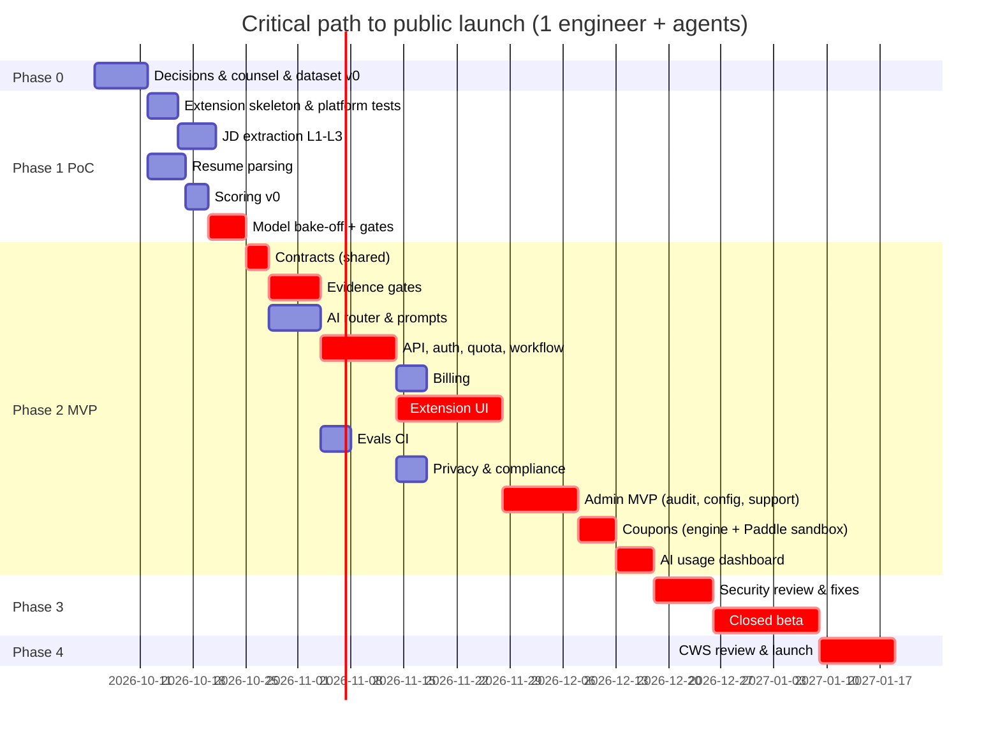

# Implementation Roadmap — AI Resume / Job Match Optimizer

**Purpose.** This document is the build plan: phases 0–5 with tasks, dependencies, effort and acceptance criteria; the critical path; the CI/CD pipeline; the testing strategy with concrete test cases; and the **coding-agent strategy** for Claude Code / Codex, including an assessment of the proposed 6-agent split and ready-to-use prompts for each phase.

Last updated: 2026-09-29 · Companion docs: [architecture.md](architecture.md), [product-requirements.md](product-requirements.md), [api-design.md](api-design.md), [database-design.md](database-design.md), [ai-model-comparison.md](ai-model-comparison.md) §9 (evals), [security-threat-model.md](security-threat-model.md)

**Labels:** **[ASSUMPTION]** · **[ESTIMATE]** · **[RECOMMENDATION]** · **[OPEN QUESTION]**

---

## Table of contents

1. [Planning assumptions](#1-planning-assumptions)
2. [Phases](#2-phases)
3. [Critical path](#3-critical-path)
4. [CI/CD pipeline](#4-cicd-pipeline)
5. [Testing strategy](#5-testing-strategy)
6. [Coding-agent strategy](#6-coding-agent-strategy)
7. [Prompts for each phase and lane](#7-prompts-for-each-phase-and-lane)
8. [Plan risks](#8-plan-risks)

---

## 1. Planning assumptions

- **[ASSUMPTION] Team:** one senior full-stack engineer (the owner) working with coding agents, plus about 0.2 FTE of design/QA help in beta. Effort is in **engineer-weeks with agent assistance**. With two engineers, calendar time drops by about 35–40%. Integration and review don't parallelize perfectly.
- **[ASSUMPTION]** Agents speed up well-specified implementation roughly 2–3×, but not the decisions, integration debugging, CWS review or legal work.
- **Rule:** evals and the Evidence Store gates are built **before** the optimization UI. Truthfulness is the #1 requirement, so it is on the critical path.

---

## 2. Phases

### Phase 0 — Research and decisions (this document set) · **1 week remaining**

| Task | Dependencies | Effort | Acceptance criteria |
|---|---|---|---|
| Owner reviews the research docs; confirms the remaining open questions (legal entity type, product name, counsel view on LinkedIn/Indeed job pages). **Already decided 2026-09-29:** GPT-6 Luna/Sol; the owner is in Canada; LinkedIn profiles are imported only by user-downloaded PDF or export; **an admin panel with coupons, runtime configuration and full traceability is in scope** ([admin-panel.md](admin-panel.md)). | – | 0.5 wk | Decisions recorded as ADRs in `docs/adr/` |
| Counsel consult (portal terms, privacy policy, PIPEDA / Quebec Law 25 / CASL, GDPR posture) + Canadian CPA (GST/HST/QST, merchant of record) | – | Parallel (external) | Written guidance on Tier B handling; privacy policy draft |
| Provider accounts: OpenAI, Anthropic, Google (paid); spend caps; separate dev/eval projects | – | 0.25 wk | Keys in the secret manager; caps set |
| Golden dataset v0: 40 JDs (via public ATS APIs/manual), 10 synthetic resumes, labels | – | 0.5 wk | Stored in `evals/datasets/` with source and licence notes |

**Exit gate:** ADRs signed off; counsel engaged; dataset v0 ready.

### Phase 1 — Proof of concept · **3 weeks**

The goal is to retire the technical risks before building the product.

| Task | Dependencies | Effort | Acceptance criteria |
|---|---|---|---|
| P1.1 Extension skeleton (WXT): side panel, `activeTab` injection, context-menu selection; **test** `openPanelOnActionClick` + activeTab, CORS to our API without host permission, and Blob download without the `downloads` permission | P0 | 0.5 wk | Open questions in [architecture.md](architecture.md) §3.4 answered with evidence |
| P1.2 JD extraction L1–L3 on 30 saved fixture pages (Greenhouse, Lever, Ashby, SmartRecruiters, Workday, iCIMS, generic) | P1.1 | 0.75 wk | ≥ 90% title/company/description correct on fixtures |
| P1.3 Resume parsing (pdf.js layout pass, mammoth + OOXML) on 10 resumes including 2-column and header-contact | – | 0.75 wk | ≥ 90% field accuracy; span IDs attached |
| P1.4 Scoring engine v0 (deterministic) + taxonomy seed (~2k skills + aliases) | P1.2, P1.3 | 0.5 wk | Deterministic outputs; the worked example in [architecture.md](architecture.md) §7.8 reproduces |
| P1.5 **Model bake-off**: `optimize@v0` on 30 JD×resume pairs with gpt-6-sol vs claude-sonnet-5-5 vs gpt-6-luna; gates G0–G6 in code; G7 with Luna | P1.3, P1.4 | 0.75 wk | Report: fabrication rate, gate-trip rate, human rubric, tokens, cost, p50/p95 latency → choose the strong-model default |
| P1.6 DOCX (`docx`) + PDF (`pdfmake`) generation of one template with a pdf.js round-trip check | P1.3 | 0.25 wk | Round-trip recovers fields in order; opens in Word/Google Docs |

**Exit gate:**

- Measured token counts replace the [ASSUMPTION]s in [cost-analysis.md](cost-analysis.md) §3.
- A strong-model decision is made.
- Hallucination after gates ≤ 2% on the bake-off set, with a path to ≤ 0.5%.

### Phase 2 — MVP · **11 weeks** (7 for the product + 4 for the admin panel, coupons and the AI usage dashboard, added 2026-09-29)

| Task | Dependencies | Effort | Acceptance criteria |
|---|---|---|---|
| P2.1 Monorepo + `packages/shared` Zod contracts (API, messages, canonical resume, job analysis) + OpenAPI generation | P1 | 0.5 wk | Contracts frozen v1; generated types used by both apps |
| P2.2 `packages/evidence`: claim extraction, index, gates G0–G6, verb ladder, number/entity normalizers | P2.1 | 1 wk | Unit tests ≥ 95% coverage; seeded fabrication set caught ≥ 95% |
| P2.3 `packages/ai`: router, providers (OpenAI, Anthropic, Google), prompt registry (6 prompts), budgets, error classes, fallback, cost logging | P2.1 | 1 wk | Contract tests with recorded fixtures; fallback chains verified |
| P2.4 `apps/api`: Hono routes, Better Auth (Google via `launchWebAuthFlow` + OTP), UserQuota DO, OptimizeWorkflow, jobs/analyze cache, Neon schema + migrations, config, feedback, account export/delete | P2.1–P2.3 | 1.5 wk | Integration tests green; quotas exact under concurrency (100 parallel reserves); idempotency verified |
| P2.5 Billing: Paddle products, checkout, webhooks, plan sync | P2.4 | 0.5 wk | Sandbox purchase → plan active in < 60 s; refund revokes credits |
| P2.6 Extension UI: all 13 screens ([product-requirements.md](product-requirements.md) §8), IndexedDB + WebCrypto storage, diff view with evidence popovers, templates ×2, export, "Have a code?" on the Upgrade screen | P2.2–P2.4 | 2 wk | US-1…US-13 acceptance criteria pass in E2E |
| P2.7 Evals in CI: promptfoo smoke suite + nightly full suite; dataset grown to 120 JDs / 24 resumes / 300 pairs | P2.3 | 0.5 wk (plus ongoing labelling) | CI blocks on hard-gate failure |
| P2.8 Privacy: consent screens, privacy policy, Limited Use statement, retention jobs, deletion workflow | P2.4 | 0.5 wk | Compliance checklist items for MVP complete ([security-threat-model.md](security-threat-model.md) §13) |
| P2.9 **Admin MVP** ([admin-panel.md](admin-panel.md) §11): `admin-api` Worker + Cloudflare Access + roles; `packages/audit` (same-transaction writes, hash chain); `packages/config` + namespaces `plans`, `features`, `kill_switches`, `limits`, `announcements` with versioning, publish to KV and signed config, rollback; users and support view, timeline, credits and complimentary grants; overview dashboard | P2.4 | 2 wk | US-15 and US-16 (for those namespaces) pass; every admin write has an audit row in the same transaction (test: failure injection rolls back both); Support can't exceed grant limits; hash-chain verify passes |
| P2.10 **Coupons** ([admin-panel.md](admin-panel.md) §7): `packages/billing` coupon engine, per-plan Paddle discount sync, preview and checkout with reservation, webhook completion, reservation sweeper, bulk codes, campaign stats, nightly Paddle reconcile | P2.5, P2.9 | 1 wk | US-13 and US-14 pass in the **Paddle sandbox**, including the §12 open-question tests (recurring intervals on 3-month prices, plan switch, expiry mid-checkout, tax); 50 concurrent attempts on the last use → exactly one succeeds |

| P2.11 **AI usage dashboard** ([admin-panel.md](admin-panel.md) §9): `packages/analytics` rollups (`ai_usage_hourly`, `ai_usage_daily.by_step`) via a Cron Trigger; analytics endpoints; pages for overview, steps, models/keys, users, plans, optimization waterfall, versions, cache, BYOK counts; AI alerts; monthly reconcile against provider usage | P2.4, P2.9 | 1 wk | US-18 (dashboard parts) passes; rollup totals equal raw `ai_requests` sums in a property test; p95 dashboard query < 1 s on 90 days of synthetic Scenario-B data |

**Exit gate:** a feature-complete MVP on staging, including the admin MVP, coupons and the AI usage dashboard; all MVP user stories pass; eval thresholds met ([ai-model-comparison.md](ai-model-comparison.md) §9.2).

### Phase 3 — Production hardening · **≈ 3.25 weeks**

| Task | Dependencies | Effort | Acceptance criteria |
|---|---|---|---|
| Security review against the threat model (30 threats, including admin #22–30); fix findings; dependency and supply-chain controls; CWS account hardening (hardware keys); admin access review | P2 | 1.25 wk | No open High findings; manifest minimal; CSP strict; admin permissions matrix tested per role |
| Observability: Sentry scrubbing, dashboards, alerts, cost dashboards, status page | P2 | 0.5 wk | Alerts fire in staging chaos tests |
| Load and chaos: k6 at 3× Scenario B peak (≈ 750 req/min to AI routes, with mocked providers); provider-outage drills; circuit breakers | P2 | 0.5 wk | p95 API overhead < 300 ms excluding LLM time; fallbacks work |
| Closed beta (50–100 users, 2 weeks, overlapping) + recruiter panel review (5–10) | P2 | 1 wk of eng + calendar | ≥ 70% "helped me tailor"; ≤ 0.5% "not true" reports per changed bullet; fixes shipped |

**Exit gate:** beta metrics met; incident runbooks written; CWS listing assets ready.

### Phase 4 — Launch · **2 weeks** (calendar driven by CWS review)

| Task | Dependencies | Effort | Acceptance criteria |
|---|---|---|---|
| CWS submission: single-purpose statement, permission justifications, privacy tab, screenshots (no third-party logos), description (no keyword lists) | P3 | 0.5 wk | Submitted. [FACT] Review "within a few days, but it can take up to a few weeks" (https://developer.chrome.com/docs/webstore/review-process). Use deferred publishing. |
| Production cut-over: provider tiers raised (OpenAI Tier 3+, Anthropic Build+), spend caps, budgets, backups | P3 | 0.25 wk | Checklists done |
| Launch content (honest ATS education), support inbox, FAQ | – | 0.5 wk | Published |
| Post-launch watch (on-call, daily cost review, rating monitoring) | Launch | 0.75 wk | No P1 open > 24 h |

### Phase 5 — Scale (ongoing, after launch)

| Item | Trigger | Effort |
|---|---|---|
| **Admin v1** ([admin-panel.md](admin-panel.md) §11): **provider registry + write-only key vault + OpenAI-compatible adapter (NVIDIA etc.)**; **model + key per step** with the data-policy rule; `ai_routing`, `prompts`, `scoring`, `extraction` and `budgets` namespaces with eval gate, canary and auto-rollback; traces explorer; **insights engine + what-if simulator**; evals page | First month after launch (or pulled into Phase 3 for +2.5 wk) | 2.5 wk |
| v1.1: optional auto-detect on Tier A (optional host permissions); BYOK Gemini paid tier; local embeddings in privacy mode | Post-launch feedback | 2–3 wk |
| v1.2: evidence-bound cover letters; original-DOCX template preservation | Demand | 3–4 wk |
| Multi-language (es, de, fr, pt) with per-language evals | Demand | 3 wk per language wave |
| LinkedIn/Indeed Tier B improvements (only per counsel guidance) | Legal clearance | 1–2 wk |
| MCP app / ChatGPT app / Claude connector | Strategy | 2–3 wk |
| Scale infra: Neon Scale plan, read replica, active–active providers, partition roll-ups, Upstash if profiling demands it | ≥ 10k MAU | 1–2 wk |
| Learned score calibration (with consented outcome data) | ≥ 10k outcomes | 3 wk |

**Totals** ([ESTIMATE]): roughly **20 weeks** of calendar time from Phase 0 to public launch for one engineer with agents (1 + 3 + 11 + 3.25 + 2), or roughly **13 weeks** with two engineers.

- Before the admin panel, coupons and AI dashboard were added on 2026-09-29, the estimate was 16 weeks, or 10–11 with two engineers.
- Building Admin v1 (keys, model per step, insights) before launch as well brings it to about 22.5 weeks.
- A second engineer could own Lane G (admin) in parallel from P2.4 onwards. That is the cleanest way to win the 4 weeks back.
- **Free NVIDIA keys can be used from Phase 1** in the eval harness (environment variables, synthetic data only) to shortlist open models. No admin panel is needed for that.

---

## 3. Critical path



---

## 4. CI/CD pipeline

```text
GitHub (PR) ─► CI
  1. install (pnpm, frozen lockfile) + cache
  2. lint (eslint) · format check · typecheck (tsc -b)
  3. unit tests (vitest) — packages/* (scoring, evidence, resume, job-extraction, ai w/ recorded fixtures)
  4. integration tests — apps/api on Workers test pool (Miniflare) + Neon branch per PR (migrations applied)
  5. build — extension (WXT prod build, source maps uploaded to Sentry), api (wrangler build)
  6. E2E — Playwright + unpacked extension against fixture job pages (served locally) + staging-mock API
  7. AI eval smoke (only if packages/ai/**, packages/evidence/**, prompts changed) — promptfoo, recorded + live (Batch/Flex where possible)
  8. security scans — CodeQL (JS/TS), dependency audit (osv-scanner/pnpm audit), secret scan (gitleaks), manifest policy check (script: no <all_urls>, CSP strict, no remote URLs in bundles)
  9. bundle checks — extension size budget; grep bundle for 'eval(' / 'new Function' / remote script URLs (fail)
 10. copy lint — forbid "ATS score", "beat the ATS", "guarantee" strings in UI/listing
main ─► CD
  - api: deploy to staging (wrangler env=staging) → smoke → manual approval → production
  - db: migrations via app_migrator (expand/contract) before deploy
  - extension: build → upload to CWS as draft (Chrome Web Store API) → deferred publish after manual approval
nightly ─► full eval suite + weekly drift run; results to eval_runs + Langfuse (synthetic only)
```

**Environments:** `dev` (local + Neon branch), `staging` (separate Cloudflare env, separate provider keys and spend caps, beta extension ID), `prod`.

**Extension release process:**

1. Bump the version.
2. CI builds and uploads the draft.
3. Submit for review.
4. When approved, publish (deferred) at a chosen time.
5. Staged rollout through a beta channel (a separate CWS item for testers).

The API supports the current extension version and the previous two ([architecture.md](architecture.md) §3.6).

---

## 5. Testing strategy

| Layer | Tool | What |
|---|---|---|
| Unit | Vitest | Scoring math, confidence, ceiling; evidence gates; normalizers (numbers, dates, entities); JD section parser; layout pass; quota math; error classification |
| Property-based | fast-check | Score ∈ [0,100]; monotonicity (adding evidence never lowers the score); gates never pass a new number; idempotent normalization |
| Contract | Zod + recorded provider fixtures | Every prompt's output schema; provider adapter parsing of success, refusal, truncation, 429 and 5xx |
| Integration (API) | Workers test pool + Neon branch | Auth flows, quota concurrency (100 parallel reserves → exact), idempotency, Workflow steps with a mocked AI, webhooks, deletion cascade |
| E2E (extension) | Playwright with the unpacked extension (`--load-extension`) | Full user journeys US-1…US-13 against locally served fixture pages; network assertions (BYOK mode sends nothing to our API) |
| Admin and billing | Workers test pool + Neon branch + **Paddle sandbox**; Playwright for `apps/admin` | Permission matrix per role; audit row written in the same transaction as every write; hash-chain verify; config bounds and rollback; coupon rules (§5.6) |
| AI evals | promptfoo + custom scorers | [ai-model-comparison.md](ai-model-comparison.md) §9 metrics and gates |
| Generation golden files | Vitest + pdf.js/mammoth re-extraction; LibreOffice headless render in CI for visual diffs | Template correctness |
| Security | CodeQL, OSV, gitleaks; custom tests | XSS payloads in JD/resume/LLM output rendering; malicious files; message-spoofing tests |
| Performance | k6 (API), Chrome performance traces (panel) | API p95; parse time for a 5-page PDF < 2 s; panel TTI < 1 s |

### 5.1 Test cases: JD extraction fixtures

These are saved HTML pages, served locally.

1. Greenhouse hosted job (server-rendered, no JSON-LD).
2. Greenhouse embed iframe on a company domain (`gh_jid`).
3. Lever job with JSON-LD.
4. Ashby SPA with JSON-LD in the head.
5. SmartRecruiters with microdata.
6. Workday open posting (JSON-LD) and **closed posting** (`postingAvailable: false`).
7. iCIMS outer page plus the `in_iframe=1` document.
8. Generic company career page with JSON-LD.
9. Generic page without structured data but with clear headings.
10. **SPA with delayed render** (content injected after 2 s).
11. "Show more" collapsed description.
12. Page with a large "similar jobs" list.
13. Page with a cookie banner overlay.
14. Duplicate mobile/desktop description blocks.
15. JD in a cross-origin iframe without access.
16. **Malicious JD:** hidden `display:none` "ignore previous instructions".
17. **Malicious JD:** visible prompt injection plus a fake requirement.
18. Zero-width and bidi characters.
19. 60k-character JD (truncation).
20. Non-English JD (es).
21. A PDF JD opened in Chrome's viewer (restricted → paste path).
22. `chrome://` and Chrome Web Store pages (restricted).
23. Page whose JSON-LD is stale versus the visible text.
24. Multi-location and salary-range JD.

### 5.2 Test cases: resume corpus

1. Single-column PDF (Word export).
2. **Two-column Canva PDF with a sidebar.**
3. Tables-based DOCX.
4. DOCX with contact in the **header**.
5. DOCX with text boxes.
6. **Scanned PDF** (image only).
7. PDF with `(cid:)` glyph garbling.
8. **Encrypted PDF.**
9. 12-page CV (limit).
10. Zip-bomb DOCX.
11. `.docm` with macros.
12. PDF with embedded JavaScript.
13. PDF with **white hidden keywords**.
14. TXT (UTF-16 BOM).
15. LinkedIn "Save to PDF".
16. LinkedIn data-export ZIP (CSV).
17. Non-English resume (de).
18. Resume with employment gaps and "Present".
19. Resume with metrics in many formats (2M, 2,000,000, $1.2M, 35%, 3x).
20. Resume with projects only (student).
21. Resume with a photo.
22. A malformed DOCX (corrupt ZIP).
23. A 0-byte file.
24. A PDF with 200 pages (reject).

### 5.3 Test cases: optimization and truthfulness

1. The model adds a metric not in evidence → G2 catches it → repair → revert.
2. The model adds "AWS" when there is no claim → G3/G4 catch it.
3. "Assisted" → "Led" → G5.
4. Kubernetes in a 2012 role (anachronism) → G6.
5. Cross-role transplant → G1.
6. A summary claims "10 years" when evidence gives 7 → contradiction check.
7. A user edit adds unsupported text → local gates → attestation prompt.
8. JD with injection → requirements are unaffected; no new claims.
9. Provider returns a refusal, truncation or invalid JSON → correct handling.
10. After score > ceiling → test failure (must be impossible).

### 5.4 Test cases: generation

1. DOCX opens in Word, LibreOffice and Google Docs (render check in CI via LibreOffice).
2. PDF text is selectable, fonts are embedded, and the reading order is correct via pdf.js.
3. Unicode names (é, ñ, Devanagari) render correctly.
4. Very long bullet wraps without breaking; 2-page overflow handled.
5. Hyperlinks are clickable and visible.
6. File size ≤ 1 MB.

### 5.5 Test cases: security

1. XSS strings in JD, resume and LLM output render as text.
2. Spoofed `runtime.sendMessage` from a page (should be impossible) and oversized messages.
3. Tampered remote config signature → rejected.
4. JWT with the wrong `aud` or expired; refresh-token reuse → family revoked.
5. Cross-user access to an optimization ID → 404.
6. Webhook with a bad signature → 401.
7. Rate-limit and quota exhaustion paths.
8. Deletion workflow completeness (no rows remain).
9. No PII in logs (log-capture test with seeded PII).
10. Admin routes without the Access JWT, with the wrong role, or without step-up → rejected; Support can't grant > 10 credits.
11. `UPDATE`/`DELETE` on `audit_log` → rejected; an edited row → `audit:verify` reports the break.
12. XSS strings in a coupon name, user display name or banner text render as text in the admin panel and the extension.

### 5.6 Test cases: coupons and config

1. Single-use code (`max_redemptions = 1`): 50 concurrent checkouts → exactly 1 reservation; the others get `limit_reached`.
2. Per-user limit: the same user redeems a shared code twice → `already_used`.
3. Code for quarterly only, used on monthly → `not_for_plan` with `eligible_plans`.
4. Different % per plan: preview and Paddle totals match per plan (sandbox).
5. Duration "2 billing periods" on the 3-month price: the discount applies to the first and second payments and not the third (sandbox, time-travel or short-cycle test price).
6. New-customers-only: a user with an earlier completed transaction → `new_customers_only`.
7. Abandoned checkout: the reservation is released after 60 min; the single-use code works again.
8. Refund with "restore use on refund" off and on.
9. Expired, not started, paused and not-found codes: expired and not started return their own reasons; paused and not-found both return `invalid`.
10. Budget cap reached → the coupon auto-pauses; an audit row with `actor_type = 'system'`.
11. Editing % off after the first redemption → rejected (`409`).
12. Nightly reconcile detects a manual edit of a Paddle discount's usage.
13. Config: out-of-bounds values rejected; an activation without a passing eval (ai_routing/prompts/scoring) rejected; a rollback restores the previous version; the `config_snapshot_id` on new `ai_requests` changes after activation.

### 5.7 Test cases: provider keys and AI analytics

1. Adding a key: request capture shows no plaintext key in any admin-api request, log or DB row; `admin_rw` can't `SELECT` `ciphertext`.
2. Only the API Worker can decrypt; a key encrypted with an old vault key version still works during rotation, then is re-wrapped.
3. A production `ai_routing` draft pointing `jd_extract` at an NVIDIA trial key → rejected (non-production scope).
4. A draft pointing `optimize` at a provider with `personal_data_allowed = false` or `trains_on_inputs ≠ no` → rejected.
5. The eval harness refuses a non-synthetic dataset for providers without `personal_data_allowed`.
6. A revoked key stops being used within ~60 s; a 401 from a provider marks the key unhealthy and the route falls back (failure scenario #47).
7. An OpenAI-compatible response without `usage` → `tokens_estimated = true` and the dashboard shows the estimated share.
8. Rollups: hourly and daily sums equal the raw `ai_requests` sums for every grouping (property test); p95 from histogram buckets is within one bucket of the exact value.
9. Per-user analytics views write `user.view` audit rows; the Analyst role gets `403` on per-user endpoints.
10. Insights: seeded data trips each rule once; accepting creates a draft config (not an activation); the measured effect is attached 7 days after activation (time-travel test).
11. What-if: re-pricing 30 days of recorded tokens with a known price book matches a hand calculation.

---

## 6. Coding-agent strategy

### 6.1 Assessment of the proposed 6-agent split

The proposal was: Agent 1 Chrome extension, 2 backend, 3 AI engine, 4 resume parsing, 5 testing, 6 infrastructure.

| Aspect | Assessment |
|---|---|
| Split by technical layer | **Partly right.** Package boundaries are good units for agents. |
| Starting all 6 in parallel | ❌ **Not optimal.** Without frozen contracts (schemas for the canonical resume, job analysis, API and messages), parallel agents invent incompatible shapes. Integration then eats the time saved. |
| A separate "Testing" agent | ❌ Tests written after the fact by another agent tend to mirror the implementation. **Each lane owns its tests (TDD)**, and a separate **adversarial verifier** agent writes red-team tests (security, fabrication, extraction edge cases) against the contracts. |
| A separate "Infrastructure" agent | ⚠️ Too little work to justify a lane. Fold it into the API lane (wrangler, Neon, CI), with a small infra/CI task at the start. |
| Missing lanes | **Evidence gates** (the core invariant) and **scoring** deserve their own lanes; they are the product's heart. **Evals** need an owner. |

### 6.2 Recommended split and order

```text
Step 0  (1 agent, sequential, human-reviewed): Scaffold + contracts
        monorepo, CI skeleton, packages/shared (zod: CanonicalResume, JobAnalysis, API DTOs, messages, errors),
        CLAUDE.md/AGENTS.md rules, ADRs. → FREEZE contracts v1 (changes only via PR reviewed by the human "integrator").

Step 1  (parallel lanes; git worktrees; each lane owns directories; no cross-lane edits)
  Lane A  job-extraction   packages/job-extraction, apps/extension/injected, tests/fixtures/jd
  Lane B  resume           packages/resume (parse + generate), tests/fixtures/resumes
  Lane C  scoring          packages/scoring, packages/taxonomy
  Lane D  evidence + ai    packages/evidence, packages/ai, evals/   (D may split into D1 evidence, D2 ai)
  Lane E  api + infra      apps/api, packages/db, packages/platform, infrastructure/, .github/workflows (deploy)
Step 2  Lane F  extension UI apps/extension (sidepanel/options/workspace) — starts once A–E expose stable package APIs (stubs allowed earlier)
        Lane G  admin        apps/admin, apps/admin-api, packages/config, packages/billing, packages/audit — starts once Lane E
                             has the DB schema, auth and Paddle webhooks (the admin contracts are frozen in Step 0 with the rest)
Step 3  Verifier agent (continuous from Step 1): adversarial tests per lane + security review; never edits src, only tests & findings
Step 4  Integrator (human + 1 agent): end-to-end wiring, E2E tests, release
```

**Why this order:** contracts first removes the main source of multi-agent failure (schema drift). Lanes map to package boundaries, so agents rarely touch the same files. The core invariant (evidence) gets focused attention. Verification is independent.

**Operating rules for agents** (put in `CLAUDE.md` / `AGENTS.md`):

1. **Never invent facts in the product.** No code path may add resume content that lacks a `claim_id`. Any change to the gates needs eval results in the PR.
2. Contracts in `packages/shared` are read-only for lanes. To propose a change, open a PR and stop.
3. No new dependencies without justification (licence, size, maintenance); **no AGPL**; no remote code in the extension; no `eval`.
4. No logging of request bodies, resume or JD text, or keys.
5. Every task ends with: tests passing, typecheck clean, and a short CHANGELOG entry in the lane's README.
6. Small PRs (< 400 lines of diff) with acceptance tests listed in the PR description.

---

## 7. Prompts for each phase and lane

These are ready to paste into Claude Code or Codex. Replace `<…>`.

### P0: scaffold and contracts (Step 0)

```text
Goal: Create the monorepo skeleton and the frozen v1 contracts for the "Job Match Optimizer" Chrome extension.
Read first: research/architecture.md (§1, §2, §5.4, §19, §20), research/api-design.md (§2–§8), research/database-design.md (§3), research/ai-model-comparison.md (§10–§11).
Do:
1. pnpm + Turborepo monorepo exactly per architecture.md §20 (empty packages with README + index.ts).
2. packages/shared: Zod schemas for CanonicalResume (architecture §5.4), ExtractedJob and JobAnalysis (architecture §4.5–4.6, api §6.4), all API request/response DTOs and error envelope (api §4, §6), extension messages (api §8). Export JSON Schema + TS types; generate docs/api/openapi.json.
3. CI skeleton (.github/workflows/ci.yml) with lint, typecheck, vitest.
4. CLAUDE.md with the agent rules in research/implementation-roadmap.md §6.2.
5. docs/adr/0001..0020 from architecture.md decision register D-01..D-20 (one paragraph each), plus the admin
   contracts: admin API DTOs (api-design.md §11), config namespace schemas (admin-panel.md §6.1) and coupon DTOs.
Constraints: no product logic; no network calls; no dependencies beyond zod, zod-to-json-schema, typescript, vitest, eslint, prettier, turbo.
Acceptance: `pnpm -w typecheck && pnpm -w test` pass; schemas round-trip the examples in api-design.md §6 (write tests for each example).
Don't: implement features, add UI, or change names from the research docs.
```

### P1: PoC tasks

```text
[P1.1 Extension platform tests] Build a minimal WXT MV3 extension (side panel + service worker + context menu) with ONLY permissions:
activeTab, scripting, sidePanel, storage, contextMenus, offscreen, identity. Write Playwright tests that answer:
(a) does openPanelOnActionClick grant activeTab so executeScript works on the active tab? (b) can the side panel fetch
https://<staging-api>/health with CORS allowing chrome-extension://<id> and no host_permissions? (c) can the side panel
download a Blob via <a download> without the downloads permission? (d) do structured-clone messages
("message_serialization":"structured_clone") pass a File from side panel to offscreen? Report results in docs/adr/0018-platform-poc.md.
Read: research/architecture.md §3. Don't add host permissions.
```

```text
[P1.5 Model bake-off] Using packages/shared contracts and evals/datasets (30 pairs), implement a throwaway script (evals/scripts/bakeoff.ts)
that runs optimize@v0 with gpt-6-sol, claude-sonnet-5-5 and gpt-6-luna (reasoning low), applies deterministic gates G0–G6
(architecture.md §6.4) and Luna entailment G7, and outputs: fabrication rate before/after gates, gate trips by type,
tokens (in/out/reasoning), $ cost using research/cost-analysis.md §2.1 prices, p50/p95 latency, and a CSV for blind human rating.
Constraints: synthetic/consented resumes only; store:false for OpenAI; no Fable models; never log resume text outside evals/.
Acceptance: report in evals/reports/bakeoff-<date>.md with a recommendation for the strong-model default.
```

### P2: lanes

```text
[Lane A — job-extraction] Implement packages/job-extraction per research/architecture.md §4 (layers L0–L5, ExtractorRegistry,
flat remote adapter config validated by a bundled JSON Schema, hidden-text removal, dedupe, jd_hash normalization) and the
self-contained injected function apps/extension/injected/extractJob.ts (no runtime imports; returns ExtractedJob ≤200 KB).
Fixtures: implement all 24 cases in research/implementation-roadmap.md §5.1 under tests/fixtures/jd with expected outputs.
Constraints: ISOLATED world only; never click/expand/navigate; no LinkedIn/Indeed-specific selectors (Tier B = generic only).
Acceptance: ≥95% field accuracy on Tier-A fixtures; malicious fixtures produce no hidden text in output; unit+fixture tests green.
```

```text
[Lane B — resume] Implement packages/resume: parsing (pdfjs-dist 6.3 with isEvalSupported:false in a worker; layout pass with
column detection, headings, bullets, dates, quality gate, hidden-text detection; mammoth + custom OOXML pass for headers/footers/
links/text boxes; TXT; LinkedIn PDF & export ZIP) producing span-annotated lines, and generation (docx 9.8 + pdfmake 0.3) of the
"Classic" and "Modern-minimal" single-column templates from CanonicalResume (architecture §9.3), with pdf.js round-trip validation.
Fixtures: research/implementation-roadmap.md §5.2 and §5.4. Enforce limits in research/security-threat-model.md §9.
Acceptance: ≥95% contact / ≥92% roles-dates on golden resumes; all malicious files rejected safely; generation golden tests green.
Don't: use AGPL libs (PyMuPDF, scribe.js), load any CDN resource, or send files to a server.
```

```text
[Lane C — scoring] Implement packages/scoring exactly per research/architecture.md §7 (states & credits, categories & weights
scoring@1.0, renormalization, hard-missing gate, keyword saturation, structure checks, confidence & range, evidence ceiling),
plus packages/taxonomy (skills + aliases + title families as data files with a loader).
Acceptance: the worked example (§7.8) reproduces exactly (score 69, confidence High); property tests: score∈[0,100], adding
demonstrated evidence never lowers score, ceiling ≥ any after-score; pure functions, no I/O.
```

```text
[Lane D1 — evidence] Implement packages/evidence: claim extraction (metrics/tools/skills/employers/titles/dates/certs) with span
links, EvidenceIndex, and gates G0–G6 + contradiction checks per research/architecture.md §6.3–6.4 (verb ladder, number/entity
normalizers incl. "2M"=2,000,000, anachronism table). Provide validateChanges(original, proposed, claims) → per-change verdicts.
Acceptance: seeded fabrication set (≥200 cases incl. §5.3 of the roadmap) caught ≥95%, false-positive rate on legitimate
rewrites ≤5%; 95% coverage. This package is the product's core invariant — be conservative: when unsure, FAIL the change.
```

```text
[Lane D2 — ai] Implement packages/ai per research/ai-model-comparison.md §10–§11: AIRouter, providers (OpenAI Responses API
with store:false & strict json_schema; Anthropic output_config.format JSON outputs, case-insensitive enums, stop_reason checks;
Google paid-tier generateContent), prompt registry (6 prompts, versioned files + hashes), budgets, error classification,
retry/fallback policy (architecture §14.1), cost computation from the ai_models price book, HostedTransport & DirectTransport
(BYOK), and the ResumeAIService facade (api-design.md §10). Add promptfoo smoke suite in evals/suites/smoke.
Acceptance: recorded-fixture contract tests for success/refusal/truncation/429/5xx/spend-cap per provider; no content in logs.
```

```text
[Lane E — api + infra] Implement apps/api (Hono on Cloudflare Workers) per research/api-design.md (all §6 endpoints, §3 auth with
Better Auth: Google via launchWebAuthFlow+PKCE and email OTP via Resend + Turnstile, §4 errors, §5 rate limits/quotas),
UserQuota Durable Object (architecture §10.2), OptimizeWorkflow (architecture §8.1, encrypted step payloads, 24h mailbox),
Paddle webhooks (§7), packages/db (Drizzle schema & migrations per research/database-design.md §3, RLS §6.2, retention jobs §7,
deletion workflow), wrangler envs (dev/staging/prod), deploy workflow.
Acceptance: integration tests incl. 100-way concurrent quota reservation exactness, idempotency, deletion completeness, webhook
signature checks; no request bodies in logs (test with seeded PII).
```

```text
[Lane F — extension UI] Implement apps/extension side panel, options and workspace per research/product-requirements.md §8
(13 screens, states, copy rules §9), storage per research/database-design.md §9 (IndexedDB + WebCrypto AES-GCM, storage.session
for secrets, setAccessLevel TRUSTED_CONTEXTS), messaging per api-design.md §8 (zod-validated), diff view with evidence popovers,
accept/reject/edit with local re-validation (packages/evidence), export via packages/resume. Manifest per architecture §3.5.
Acceptance: Playwright E2E for user stories US-1…US-13 (product-requirements §11); copy-lint passes (no "ATS score");
BYOK E2E asserts zero requests to our API.
```

```text
[Lane G — admin + coupons] Implement the admin plane per research/admin-panel.md: apps/admin-api (Hono Worker, separate
deployment, /admin/v1 per research/api-design.md §11; verify the Cloudflare Access JWT; Better Auth admin roles with the
permission matrix in admin-panel.md §4.2; impersonation removed; step-up for dangerous actions), packages/audit (audit_log
row in the SAME transaction as every write; hash chain; verifier), packages/config (Zod schema + hard bounds per namespace,
versioning, diff, snapshot hashing, publish to KV + signed /v1/config, rollback), packages/billing (coupon engine per
admin-panel.md §7: per-plan rules, reservations with row locks, Paddle non-checkout discounts with restrict_to, webhook
completion, sweeper, nightly reconcile), and apps/admin (Refine or react-admin SPA: modules in admin-panel.md §5).
Tables: research/database-design.md §3.6 and the audit_log in §3.5.
Constraints: no resume/JD content anywhere in admin; emails masked by default; every personal-data read audited; secrets
never displayed; bounds live in code and are not themselves configurable.
Acceptance: research/implementation-roadmap.md §5.6 tests and §5.5 #10–12 pass (Paddle sandbox for coupons); US-13…US-16.
Then (P2.11): packages/analytics rollups + the AI usage dashboard per admin-panel.md §9.1–9.4 and §9.7; acceptance: §5.7 #7–9, US-18 (dashboard).
Admin v1 (after launch): packages/vault (browser-side encryption with the vault public key; Worker-side decryption), provider and
model registry, openai_compatible adapter in packages/ai, ai_routing with the data-policy rule (admin-panel.md §6.5.3), insights
engine and what-if (§9.5–9.6); acceptance: §5.7 all, US-17, US-18.
```

```text
[Verifier (adversarial) — continuous] You write ONLY tests and findings, never product code. For each merged lane, read the
contracts and research/security-threat-model.md §11, then add adversarial tests: prompt-injection JDs, fabrication attempts,
malicious files, XSS strings, message spoofing, quota races, deletion gaps. File findings as issues with severity and repro.
```

### P3: hardening

```text
[Security review] Review the repository against research/security-threat-model.md (threats 1–30, controls §5–§10, checklist §13).
Produce docs/security/review-<date>.md with findings (severity, file:line, fix). Verify: manifest minimal, CSP strict, no remote
code, no eval, no PII in logs, secrets not in code, RLS enabled, deletion complete. Do not change behaviour without tests.
```

```text
[Load & chaos] Write k6 scripts for AI routes with mocked providers at 3× Scenario B peak (research/cost-analysis.md §6), plus
chaos toggles (provider 429/5xx/timeout, Neon unavailable). Verify circuit breakers, fallbacks, quota exactness, p95 overhead <300ms.
```

### P4: launch

```text
[CWS listing & compliance] Draft the Chrome Web Store listing (single purpose statement from research/product-requirements.md §1,
permission justifications per architecture.md §3.4, privacy-tab answers consistent with the privacy policy, description without
brand/keyword lists or "ATS score" claims, non-affiliation disclaimer), the privacy policy and Limited Use statement from
research/security-threat-model.md §3–§4 and §13. Output to apps/web/content/. Flag every statement that needs counsel review.
```

---

## 8. Plan risks

| Risk | Impact on the plan | Mitigation |
|---|---|---|
| Bake-off shows high residual fabrication | +1–2 weeks | Tighter edit budget; stronger gates; Sonnet/Sol swap; reduce the rewrite scope to phrasing only |
| CWS review rejection (permissions, data disclosure) | +1–3 weeks | Minimal permissions; thorough privacy tab; deferred publishing; appeal via dashboard |
| Counsel restricts Tier B further | Scope | Select/paste already covers it |
| WXT or pdfmake limitations found in the PoC | +0.5–1 week | Fallbacks: plain Vite + CRX tooling; Browser Run PDF |
| Provider price or model changes | Cost | Price book + router; weekly drift evals |
| Solo-founder bandwidth | Timeline | Strict MVP scope ([product-requirements.md](product-requirements.md) §10) |
| Admin scope creep ("everything configurable") | +1–3 weeks | Ship the Admin MVP namespaces first; AI, prompt and scoring config stays git + deploy until Admin v1; invariants stay code-only ([admin-panel.md](admin-panel.md) §2) |
| Paddle discount behaviour differs from the docs (recurring intervals, plan switch, expiry) | +0.5 week | Sandbox tests first in P2.10; fall back to "first payment only" coupons if multi-period behaves unexpectedly |
